# Informe Técnico: Simulador de Inferencia Bayesiana Secuencial (`med-diagnosis`)

**Proyecto:** `med-diagnosis` (versión `0.2.0`)  
**Rama:** `new-develop`  
**Stack principal:** Python 3.11+ · Streamlit · Plotly · SQLite (`sqlite3`) · `pytest` · `ruff`  
**Documento base de especificación:** [MateDiscreta.pdf](file:///Users/hd/Projects/github.com/Aireck2/med-diagnosis/MateDiscreta.pdf)

---

## 1. Desarrollo

El proyecto `med-diagnosis` implementa un **Simulador de Inferencia Bayesiana Secuencial** interactivo para modelar, demostrar algebraicamente y visualizar la actualización iterativa de probabilidades en protocolos escalonados de diagnóstico médico. Su propósito central es neutralizar el **sesgo de la tasa base** (_base rate fallacy_), evidenciando por qué una prueba aislada de tamizaje en poblaciones de baja prevalencia genera un volumen elevado de falsos positivos y cómo el encadenamiento secuencial de pruebas con mecanismos biológicos diferenciados converge hacia la certeza diagnóstica.

El desarrollo se organizó bajo una arquitectura desacoplada por capas (`domain/`, `data/`, `ui/` y `app.py`) con trazabilidad directa a los parámetros epidemiológicos oficiales de la **Tabla 1** de [MateDiscreta.pdf](file:///Users/hd/Projects/github.com/Aireck2/med-diagnosis/MateDiscreta.pdf) para tres patologías infecciosas de alta relevancia sanitaria en el Perú: **COVID-19 (SARS-CoV-2)**, **Tuberculosis Pulmonar (TB)** y **Dengue (DENV 1-4)**.

---

## 2. Identificación de Requerimientos

### 2.1 Requerimientos Funcionales (RF)

| Código    | Requerimiento                                                                                                                                                                                                                                           | Implementación en el repositorio                                                                                                                                                                                                                                                                                                                             |
| :-------- | :------------------------------------------------------------------------------------------------------------------------------------------------------------------------------------------------------------------------------------------------------ | :----------------------------------------------------------------------------------------------------------------------------------------------------------------------------------------------------------------------------------------------------------------------------------------------------------------------------------------------------------- | --------------------------------------------------------------------------- | -------------------------------------------------------------------------------------------------------------------- |
| **RF-01** | Modelar el espacio muestral finito $\Omega = E \cup E^c$ ($E \cap E^c = \emptyset$) y la partición booleana inicial $P_0(E) + P_0(E^c) = 1$ a partir del estrato sintomático o epidemiológico ($t = 0$).                                                | [models.py](file:///Users/hd/Projects/github.com/Aireck2/med-diagnosis/src/med_diagnosis/domain/models.py) (`PrevalenceScenario`, `SimulationTrace`)                                                                                                                                                                                                         |
| **RF-02** | Ejecutar la actualización bayesiana iterativa en cada etapa $t \in \{1, \dots, n\}$ mediante la Ley de la Probabilidad Total y la regla de recurrencia del Teorema de Bayes usando aritmética racional exacta (`fractions.Fraction`).                   | [bayes.py](file:///Users/hd/Projects/github.com/Aireck2/med-diagnosis/src/med_diagnosis/domain/bayes.py) (`apply_bayes_step`, `run_bayesian_sequence`)                                                                                                                                                                                                       |
| **RF-03** | Almacenar y validar en una base de datos relacional los 8 estratos de prevalencia, 9 pruebas diagnósticas y 7 fuentes oficiales (CDC Perú, MINSA, OMS, OPS, Cochrane) de la Tabla 1.                                                                    | [schema.sql](file:///Users/hd/Projects/github.com/Aireck2/med-diagnosis/src/med_diagnosis/data/schema.sql), [epidemiology_seed.json](file:///Users/hd/Projects/github.com/Aireck2/med-diagnosis/src/med_diagnosis/data/epidemiology_seed.json), [database.py](file:///Users/hd/Projects/github.com/Aireck2/med-diagnosis/src/med_diagnosis/data/database.py) |
| **RF-04** | Soportar encadenamiento en **modo guiado + flexible**: iniciar con el protocolo clínico `1 -> 2 -> 3` y permitir alternar resultados (`+` / `-`), añadir, quitar o reordenar pruebas y superponer la secuencia invertida para comprobar conmutatividad. | [bayes.py](file:///Users/hd/Projects/github.com/Aireck2/med-diagnosis/src/med_diagnosis/domain/bayes.py) (`build_guided_sequence`, `move_application`, `reverse_sequence`) y [app.py](file:///Users/hd/Projects/github.com/Aireck2/med-diagnosis/app.py)                                                                                                     |
| **RF-05** | Desplegar la demostración algebraica paso a paso en LaTeX desde $t = 0$ (estrato sintomático) hasta $t = n$, además de comparar simultáneamente todos los estratos sintomáticos de la patología seleccionada.                                           | [math_walkthrough.py](file:///Users/hd/Projects/github.com/Aireck2/med-diagnosis/src/med_diagnosis/ui/math_walkthrough.py), [charts.py](file:///Users/hd/Projects/github.com/Aireck2/med-diagnosis/src/med_diagnosis/ui/charts.py)                                                                                                                           |
| **RF-06** | Traducir las probabilidades racionales a **frecuencias naturales** sobre una cohorte finita $                                                                                                                                                           | \Omega                                                                                                                                                                                                                                                                                                                                                       | \in \{1\,000, 10\,000, 100\,000\}$ mostrando $VP, FP, FN$ y $VN$ por etapa. | [frequencies.py](file:///Users/hd/Projects/github.com/Aireck2/med-diagnosis/src/med_diagnosis/domain/frequencies.py) |
| **RF-07** | Proveer casos demostrativos rápidos de baja y alta prevalencia, así como secuencias concordantes y discordantes.                                                                                                                                        | [presets.py](file:///Users/hd/Projects/github.com/Aireck2/med-diagnosis/src/med_diagnosis/ui/presets.py)                                                                                                                                                                                                                                                     |

### 2.2 Requerimientos No Funcionales (RNF)

| Código     | Requerimiento                                      | Criterio de cumplimiento                                                                                                                                                                                                                                             |
| :--------- | :------------------------------------------------- | :------------------------------------------------------------------------------------------------------------------------------------------------------------------------------------------------------------------------------------------------------------------- |
| **RNF-01** | Desacoplamiento estricto de capas                  | `med_diagnosis.domain` usa exclusivamente la biblioteca estándar de Python (verificado por análisis AST en [test_architecture_boundaries.py](file:///Users/hd/Projects/github.com/Aireck2/med-diagnosis/tests/test_architecture_boundaries.py)).                     |
| **RNF-02** | Exactitud numérica sin deriva de punto flotante    | Cálculos probabilísticos ejecutados con `fractions.Fraction`; conversión a porcentaje decimal únicamente en la capa de presentación.                                                                                                                                 |
| **RNF-03** | Operación 100 % offline y tolerante a solo lectura | La base SQLite empaquetada ([epidemiology.db](file:///Users/hd/Projects/github.com/Aireck2/med-diagnosis/src/med_diagnosis/data/epidemiology.db)) incluye respaldo determinista en memoria si el sistema de archivos es de solo lectura (Streamlit Community Cloud). |
| **RNF-04** | Alcance ético y pedagógico explícito               | Banner permanente en [app.py](file:///Users/hd/Projects/github.com/Aireck2/med-diagnosis/app.py) y sección de limitaciones (§1.4) aclarando que no es dispositivo médico ni sustituye el criterio clínico.                                                           |
| **RNF-05** | Calidad, mantenibilidad y convención bilingüe      | Identificadores en inglés; interfaz, documentación y comentarios explicativos en español neutro; validación automática con `pytest` y `ruff`.                                                                                                                        |

---

## 3. Análisis de Hardware

El sistema se desarrolla, empaqueta (`setuptools` / _wheel_) y ejecuta tanto en estaciones locales como en contenedores ligeros en la nube. La siguiente tabla contrasta las estaciones físicas empleadas durante el ciclo de desarrollo y compilación frente a los requisitos mínimos de operación:

| Recurso Físico                     | Estación 1 (MacBook Pro 13", 2020)                           | Estación 2 (HP ENVY 14 Notebook PC)               | Estación 3 (HP Pavilion - i5 10ª Gen)           | Estación 4 (ROG Zephyrus - Ryzen 9 7ª Gen)              | Requisito Mínimo del Sistema                                                      |
| :--------------------------------- | :----------------------------------------------------------- | :------------------------------------------------ | :---------------------------------------------- | :------------------------------------------------------ | :-------------------------------------------------------------------------------- |
| **Sistema Operativo**              | macOS (Apple)                                                | Windows 10 Pro 64-bit (v10.0.19045)               | Windows 10 / 11 64-bit                          | Windows 10 / 11 64-bit                                  | SO compatible con Python 3.11+ (x86-64 o ARM64)                                   |
| **Procesador (CPU)**               | Intel Core multi-núcleo / Apple Silicon a 2.0 GHz o superior | Intel Core Family 6 Model 69 (x86-64) a ~1.70 GHz | Intel Core i5 (10ª Gen) multi-núcleo            | AMD Ryzen 9 (7ª Gen) multi-núcleo de alto rendimiento   | 1 núcleo físico x86-64 o ARM64 a 1.5 GHz                                          |
| **Memoria Principal (RAM)**        | 8 GB / 16 GB LPDDR4X unificada                               | 16 GB DDR3/DDR4 (16,314 MB)                       | 16 GB DDR4                                      | 16 GB DDR4 / LPDDR5                                     | 512 MB libres para CPython, SQLite en memoria y servidor Streamlit                |
| **Almacenamiento Secundario**      | Unidad de Estado Sólido (SSD NVMe) PCIe                      | Unidad de Almacenamiento Secundario (HDD/SSD)     | SSD NVMe de 512 GB                              | SSD NVMe M.2 de 512 GB de alta velocidad                | 250 MB libres en disco (código fuente, SQLite y entorno virtual)                  |
| **Puertos y Conectividad**         | Puertos Thunderbolt 3 (USB-C de hasta 40 Gbps)               | Adaptador Ethernet GbE, Wi-Fi 802.11n             | Puertos USB 3.1 / USB-C, Wi-Fi / LAN            | Puertos USB-C, USB 3.2, Wi-Fi 6 / 6E                    | Interfaz de red local (`localhost`) para desarrollo; salida HTTPS para despliegue |
| **Dispositivos de Entrada/Salida** | Magic Keyboard, trackpad Force Touch y pantalla Retina       | Teclado físico estándar, touchpad y pantalla HD   | Teclado retroiluminado, touchpad y pantalla FHD | Teclado mecánico/membrana optimizado, pantalla IPS/OLED | Teclado estándar, terminal interactiva y navegador web moderno                    |

---

## 4. Análisis de Software

| Categoría                      | Tecnología / Paquete            | Versión / Restricción             | Función técnica en el proyecto                                                        |
| :----------------------------- | :------------------------------ | :-------------------------------- | :------------------------------------------------------------------------------------ |
| **Lenguaje y Runtime**         | Python (CPython)                | `>= 3.11` (validado en `3.12.13`) | Ejecución del motor discreto, persistencia relacional y aplicación web.               |
| **Aritmética Exacta**          | `fractions.Fraction` (stdlib)   | Integrado en Python               | Representación racional exacta $\frac{a}{b}$ sin pérdida de precisión flotante.       |
| **Motor Relacional**           | `sqlite3` (stdlib)              | Integrado en Python               | Base de datos embebida en Tercera Forma Normal (3FN) con claves foráneas y `CHECK`.   |
| **Framework Web**              | `streamlit`                     | `>= 1.39, < 2`                    | Interfaz interactiva reactiva, renderizado LaTeX y gestión de estado de sesión.       |
| **Motor Gráfico**              | `plotly`                        | `>= 5.20, < 8`                    | Curvas de evolución probabilística, comparativa multi-estrato y gráficos de cohortes. |
| **Construcción y Empaquetado** | `setuptools` + `pyproject.toml` | `>= 68` (PEP 621)                 | Empaquetado modular bajo `src/med_diagnosis` e inclusión de datos empaquetados.       |
| **Pruebas y Cobertura**        | `pytest`, `pytest-cov`          | `>= 8.0` / `>= 5.0`               | Verificación unitaria, propiedades algebraicas, base SQLite, AST y `AppTest`.         |
| **Análisis Estático**          | `ruff`                          | `>= 0.6`                          | Verificación de estilo, orden de importaciones y formateo determinista.               |

---

## 5. Solución del Caso

### 5.1. Análisis y Descomposición (Subcomponentes)

Aplicando el principio de **divide y vencerás**, el problema global de simular y explicar protocolos de diagnóstico médico secuencial se descompone en **cinco subcomponentes lógicos independientes**. Cada módulo resuelve un único subproblema bien delimitado, evita acoplarse a los detalles internos de los demás y se comunica exclusivamente mediante estructuras de datos inmutables.

#### Descripción funcional de los subcomponentes

1. **Subcomponente A: Gestor de Persistencia y Validación Epidemiológica**  
   Administra el conocimiento clínico oficial del sistema. Transforma los registros tabulares de patologías, estratos de prevalencia inicial, sensibilidad, especificidad y referencias bibliográficas en entidades consistentes, verificando que ninguna probabilidad viole los axiomas básicos del intervalo $[0, 1]$ ni la relación complementaria entre especificidad y tasa de falsos positivos.
2. **Subcomponente B: Configurador de Protocolo Secuencial (Modo Guiado y Flexible)**  
   Gobierna la construcción de la cadena finita de pruebas diagnósticas que se aplicará al caso de estudio. Permite iniciar con la secuencia escalonada estándar recomendada por las guías clínicas, pero también habilita insertar, suprimir, permutar o invertir el orden de las etapas y asignar a cada prueba un resultado observado positivo o negativo.
3. **Subcomponente C: Motor de Inferencia Bayesiana Secuencial Exacta**  
   Constituye el núcleo matemático puro del sistema. A partir de la prevalencia previa del estrato inicial ($t = 0$), recorre iterativamente cada eslabón de la secuencia diagnóstica aplicando la Ley de la Probabilidad Total y la regla de recurrencia del Teorema de Bayes mediante aritmética racional exacta, entregando la evolución paso a paso de la probabilidad de enfermedad y de su complemento sano.
4. **Subcomponente D: Descomponedor Poblacional en Frecuencias Naturales**  
   Traduce las probabilidades racionales abstractas de cada etapa a conteos concretos de personas sobre una cohorte finita $|\Omega| = N$. En cada transición subdivide a los individuos enfermos en verdaderos positivos y falsos negativos, y a los individuos sanos en falsos positivos y verdaderos negativos, garantizando que la suma de las partes conserve exactamente el total de la población.
5. **Subcomponente E: Generador de Demostración Algebraica y Visualización Interactiva**  
   Recibe la traza matemática producida por el motor y la convierte en representaciones comprensibles para el usuario: ecuaciones simbólicas sustituidas paso a paso desde $t = 0$ hasta $t = n$, curvas comparativas de evolución probabilística, contrastes simultáneos entre distintos estratos sintomáticos y gráficos de barras poblacionales.

#### Matriz Entrada-Proceso-Salida (E-P-S) por Subcomponente

| Subcomponente                                   | Entradas (E)                                                                                                                                             | Procesos Lógicos (P)                                                                                                                                                                                                                                                                                                                                                                     | Salidas (S)                                                                                                                                                      |
| :---------------------------------------------- | :------------------------------------------------------------------------------------------------------------------------------------------------------- | :--------------------------------------------------------------------------------------------------------------------------------------------------------------------------------------------------------------------------------------------------------------------------------------------------------------------------------------------------------------------------------------- | :--------------------------------------------------------------------------------------------------------------------------------------------------------------- |
| **A. Persistencia y Validación Epidemiológica** | Catálogo declarativo de patologías, prevalencias por estrato, sensibilidades, especificidades y citas oficiales; identificador de patología consultada.  | 1. Verificar integridad relacional y cotas de probabilidad $(0, 1]$.<br>2. Comprobar identidad $P(+ \mid E^c) = 1 - \text{Especificidad}$.<br>3. Construir el perfil estructurado e inmutable de la patología.                                                                                                                                                                           | Perfil epidemiológico validado con estratos iniciales ($t = 0$), catálogo ordenado de pruebas y referencias bibliográficas.                                      |
| **B. Configurador de Protocolo Secuencial**     | Catálogo de pruebas de la patología activa; selección de modo (guiado o personalizado); operaciones de edición de orden y signos observados ($+$ o $-$). | 1. Generar por defecto el orden clínico escalonado $1 \to 2 \to 3$.<br>2. Aplicar desplazamientos de posición, adiciones o eliminaciones de etapas.<br>3. Generar opcionalmente la cadena invertida para contraste de conmutatividad.                                                                                                                                                    | Sucesión ordenada y finita de aplicaciones de prueba $(T_1, O_1), (T_2, O_2), \dots, (T_n, O_n)$.                                                                |
| **C. Motor de Inferencia Bayesiana Secuencial** | Probabilidad previa inicial $P_0(E)$ del estrato elegido; sucesión ordenada de etapas $(T_t, O_t)$ para $t = 1 \dots n$.                                 | 1. Establecer en $t = 0$ la partición $P_0(E^c) = 1 - P_0(E)$.<br>2. Seleccionar en cada paso $t$ las verosimilitudes condicionales según $O_t \in \{+_t, -_t\}$.<br>3. Evaluar la probabilidad marginal $P(O_t)$ por Probabilidad Total.<br>4. Calcular el cociente racional exacto $P_t(E) = \frac{P(O_t \mid E)P_{t-1}(E)}{P(O_t)}$ y asignar $P_t(E)$ como nuevo _prior_ de $t + 1$. | Traza secuencial exacta con los estados $(P_0(E), P_1(E), \dots, P_n(E))$, sus complementos sanos, probabilidades conjuntas, marginales y variaciones por etapa. |
| **D. Descomponedor en Frecuencias Naturales**   | Probabilidad inicial $P_0(E)$, estados intermedios de cada etapa $t$ y tamaño de cohorte finita $N > 0$.                                                 | 1. Particionar la cohorte inicial en enfermos esperados $E$ y sanos esperados $E^c$.<br>2. Subdividir en cada prueba $E$ en $(VP_t, FN_t)$ y $E^c$ en $(FP_t, VN_t)$.<br>3. Aplicar redondeo entero conservativo preservando las sumas exactas por subgrupo.                                                                                                                             | Tabla secuencial de conteos poblacionales enteros y racionales por etapa, junto con el cociente directo sobre los individuos positivos o negativos.              |
| **E. Demostrador Algebraico y Visualizador**    | Traza secuencial principal, traza permutada opcional, trazas comparativas de todos los estratos $t = 0$ y tabla de frecuencias naturales.                | 1. Ensamblar las expresiones algebraicas sustituidas para $t = 0$ y los cuatro pasos de Bayes en cada $t \ge 1$.<br>2. Trazar las curvas de evolución de $P_t(E)$ y $P_t(E^c)$ y la comparativa multi-estrato.<br>3. Construir las gráficas comparativas de subpoblaciones $VP, FP, FN, VN$.                                                                                             | Tablero interactivo con indicadores resumen, demostración matemática desplegable etapa por etapa, gráficas dinámicas y matriz epidemiológica.                    |

#### Flujo de Datos entre Subcomponentes

El flujo de información es estrictamente **unidireccional y acíclico**:

1. El **Subcomponente A** entrega el perfil epidemiológico validado al **Subcomponente B** y al **Subcomponente C**.
2. El **Subcomponente B** recoge las decisiones del usuario y construye la secuencia finita de observaciones $(T_1, O_1) \dots (T_n, O_n)$, que entrega como entrada al **Subcomponente C**.
3. El **Subcomponente C** ejecuta la recurrencia matemática pura y transfiere los resultados racionales de cada transición al **Subcomponente D** para obtener la proyección demográfica sobre $N$ individuos.
4. Finalmente, el **Subcomponente E** consume la traza completa (probabilidades exactas y frecuencias naturales) y presenta las vistas analíticas sin alterar ni recalcular las reglas de negocio.

---

### 5.2. Diseño (Diagramas de Flujo y Diagrama de Clases del Dominio)

#### 5.2.1. Diagrama de Flujo 1: Flujo Operativo General e Interacción del Simulador

Sintetiza en **9 nodos** la coordinación completa desde la lectura del catálogo epidemiológico SQLite y la bifurcación entre casos demostrativos o configuración personalizada hasta la ejecución del núcleo bayesiano, la verificación opcional de conmutatividad y el renderizado del tablero interactivo ([abrir lámina HTML original](file:///Users/hd/Projects/github.com/Aireck2/med-diagnosis/docs/diagrams/flujo-operativo.html)).


#### 5.2.2. Diagrama de Flujo 2: Algoritmo Iterativo de Inferencia Bayesiana Secuencial

Modela en **9 nodos** el ciclo discreto que inicializa la partición booleana en $t = 0$, evalúa la condición de parada $t \le n$, selecciona las verosimilitudes condicionales según el signo observado, aplica la Ley de la Probabilidad Total junto con la recurrencia de Bayes y particiona la cohorte $|\Omega| = N$ antes de avanzar a $t + 1$ ([abrir lámina HTML original](file:///Users/hd/Projects/github.com/Aireck2/med-diagnosis/docs/diagrams/algoritmo-bayes.html)).



#### 5.2.3. Diagrama de Clases del Dominio (`med_diagnosis.domain`)

Representa la estructura estática de las **7 clases inmutables** de `med_diagnosis.domain`, destacando a `SimulationTrace` como agregado raíz compuesto por los resultados secuenciales (`BayesianStepResult`) y las particiones demográficas (`NaturalFrequencyBreakdown`), asociado al estrato inicial (`PrevalenceScenario`) e integrado con el catálogo clínico (`PathologyProfile`, `TestApplication` y `DiagnosticTestSpec`) mediante composición y agregación ([abrir lámina HTML original](file:///Users/hd/Projects/github.com/Aireck2/med-diagnosis/docs/diagrams/dominio-clases.html)).



---

### 5.3. Implementación (Programación)

A continuación se presenta el código fuente funcional del sistema, organizado en sus tres capas operativas (dominio matemático racional, persistencia relacional SQLite e interfaz interactiva en Streamlit), excluyendo archivos de configuración, semillas de datos y suites de prueba.

#### 5.3.1. Núcleo Matemático del Dominio (`src/med_diagnosis/domain/`)

##### Archivo: `src/med_diagnosis/domain/models.py`

```python
"""Modelos inmutables de dominio para la inferencia diagnóstica bayesiana secuencial.

Todas las probabilidades se representan como números racionales exactos
(`fractions.Fraction`) sobre la partición booleana finita
Omega = E U E^c, con E cap E^c = conjunto vacío.
"""

from __future__ import annotations

from dataclasses import dataclass
from enum import StrEnum
from fractions import Fraction


class Observation(StrEnum):
    """Resultado binario producido por una prueba diagnóstica en la etapa discreta t >= 1."""

    POSITIVE = "+"
    NEGATIVE = "-"

    @property
    def label_es(self) -> str:
        """Retorna la etiqueta clínica en español neutro para mostrar en la interfaz."""
        return "Positivo (+)" if self is Observation.POSITIVE else "Negativo (-)"


@dataclass(frozen=True)
class Citation:
    """Referencia epidemiológica o clínica oficial que respalda los parámetros del modelo."""

    cite_key: str
    short_label: str
    full_reference: str
    pub_year: int
    doi_or_url: str = ""


@dataclass(frozen=True)
class PrevalenceScenario:
    """Estrato clínico o sintomático inicial en t = 0 que define P_0(E)."""

    scenario_id: int
    pathology_slug: str
    stratum_name: str
    clinical_description: str
    prior: Fraction
    display_order: int

    def __post_init__(self) -> None:
        # Validar que la probabilidad previa P_0(E) pertenezca estrictamente a (0, 1)
        if not (Fraction(0) < self.prior < Fraction(1)):
            raise ValueError(
                f"Prior probability P_0(E) must be strictly in (0, 1), got {self.prior!r}"
            )

    @property
    def complement(self) -> Fraction:
        """Retorna la probabilidad del complemento sano P_0(E^c) = 1 - P_0(E)."""
        return Fraction(1) - self.prior


@dataclass(frozen=True)
class DiagnosticTestSpec:
    """Especificación de rendimiento clínico de una prueba diagnóstica."""

    test_id: int
    pathology_slug: str
    default_step_order: int
    name: str
    sensitivity: Fraction
    specificity: Fraction
    biological_mechanism: str

    def __post_init__(self) -> None:
        # Validar que sensibilidad y especificidad estén dentro de (0, 1]
        if not (Fraction(0) < self.sensitivity <= Fraction(1)):
            raise ValueError(f"Sensitivity P(+|E) must be in (0, 1], got {self.sensitivity!r}")
        if not (Fraction(0) < self.specificity <= Fraction(1)):
            raise ValueError(f"Specificity P(-|E^c) must be in (0, 1], got {self.specificity!r}")

    @property
    def false_positive_rate(self) -> Fraction:
        """Retorna la tasa de falsos positivos P(+|E^c) = 1 - Especificidad."""
        return Fraction(1) - self.specificity

    @property
    def false_negative_rate(self) -> Fraction:
        """Retorna la tasa de falsos negativos P(-|E) = 1 - Sensibilidad."""
        return Fraction(1) - self.sensitivity


@dataclass(frozen=True)
class PathologyProfile:
    """Perfil epidemiológico completo de una patología de estudio."""

    slug: str
    name: str
    target_population: str
    clinical_context: str
    scenarios: tuple[PrevalenceScenario, ...]
    tests: tuple[DiagnosticTestSpec, ...]
    citations: tuple[Citation, ...]


@dataclass(frozen=True)
class TestApplication:
    """Aplicación individual de una prueba en la etapa t con observación binaria (+ o -)."""

    __test__ = False

    test: DiagnosticTestSpec
    observation: Observation


@dataclass(frozen=True)
class NaturalFrequencyBreakdown:
    """Partición de frecuencias naturales sobre una cohorte finita |Omega| = cohort_size."""

    step_index: int
    stage_label: str
    cohort_size: int
    entering_prior: Fraction
    exact_diseased: Fraction
    exact_healthy: Fraction
    rounded_diseased: int
    rounded_healthy: int
    observation: Observation | None = None
    test_name: str | None = None
    exact_true_positives: Fraction | None = None
    exact_false_negatives: Fraction | None = None
    exact_false_positives: Fraction | None = None
    exact_true_negatives: Fraction | None = None
    rounded_true_positives: int | None = None
    rounded_false_negatives: int | None = None
    rounded_false_positives: int | None = None
    rounded_true_negatives: int | None = None

    @property
    def exact_posterior_from_counts(self) -> Fraction:
        """Calcula la probabilidad posterior directamente del cociente exacto de subpoblaciones."""
        if self.observation is None:
            return self.entering_prior
        if self.observation is Observation.POSITIVE:
            assert self.exact_true_positives is not None
            assert self.exact_false_positives is not None
            total_pos = self.exact_true_positives + self.exact_false_positives
            return self.exact_true_positives / total_pos
        assert self.exact_false_negatives is not None
        assert self.exact_true_negatives is not None
        total_neg = self.exact_false_negatives + self.exact_true_negatives
        return self.exact_false_negatives / total_neg


@dataclass(frozen=True)
class BayesianStepResult:
    """Estado completo de una transición individual de t - 1 a t bajo el Teorema de Bayes."""

    step_index: int
    application: TestApplication
    prior: Fraction
    prior_complement: Fraction
    likelihood_disease: Fraction
    likelihood_healthy: Fraction
    joint_disease: Fraction
    joint_healthy: Fraction
    marginal_observation_prob: Fraction
    posterior: Fraction
    posterior_complement: Fraction
    belief_delta: Fraction


@dataclass(frozen=True)
class SimulationTrace:
    """Trayectoria secuencial completa desde t = 0 hasta t = n."""

    pathology_slug: str
    pathology_name: str
    scenario: PrevalenceScenario
    steps: tuple[BayesianStepResult, ...]
    frequencies: tuple[NaturalFrequencyBreakdown, ...]
    cohort_size: int

    @property
    def initial_prior(self) -> Fraction:
        """Retorna P_0(E) en la etapa inicial t = 0."""
        return self.scenario.prior

    @property
    def final_posterior(self) -> Fraction:
        """Retorna P_n(E) tras la última prueba aplicada (o P_0(E) si no hay pruebas)."""
        return self.steps[-1].posterior if self.steps else self.scenario.prior

    @property
    def final_complement(self) -> Fraction:
        """Retorna el complemento sano final P_n(E^c) = 1 - P_n(E)."""
        return Fraction(1) - self.final_posterior

    @property
    def total_belief_shift(self) -> Fraction:
        """Retorna el cambio neto acumulado P_n(E) - P_0(E)."""
        return self.final_posterior - self.initial_prior

    @property
    def probabilities_by_stage(self) -> tuple[Fraction, ...]:
        """Retorna la tupla ordenada (P_0(E), P_1(E), ..., P_n(E))."""
        return (self.scenario.prior, *(s.posterior for s in self.steps))

    @property
    def complements_by_stage(self) -> tuple[Fraction, ...]:
        """Retorna la tupla ordenada (P_0(E^c), P_1(E^c), ..., P_n(E^c))."""
        return tuple(Fraction(1) - p for p in self.probabilities_by_stage)


@dataclass(frozen=True)
class ParameterMatrixRow:
    """Fila resumen plana equivalente a la Tabla 1 de MateDiscreta.pdf."""

    pathology_slug: str
    pathology_name: str
    target_population: str
    default_step_order: int
    test_name: str
    sensitivity: Fraction
    specificity: Fraction
    false_positive_rate: Fraction
    biological_mechanism: str
    priors_summary: str
    citations_summary: str
```

##### Archivo: `src/med_diagnosis/domain/bayes.py`

```python
"""Motor racional exacto de Inferencia Bayesiana Secuencial.

Implementa (MateDiscreta.pdf Sección 1.3):
1. Verosimilitudes condicionales P(O_t | E) y P(O_t | E^c).
2. Ley de la Probabilidad Total P(O_t) = P(O_t | E) P_{t-1}(E) + P(O_t | E^c) P_{t-1}(E^c).
3. Relación de recurrencia bayesiana:
       P_t(E) = P(O_t | E) P_{t-1}(E) / P(O_t)
4. Constructores de secuencias en modo guiado + flexible y comparativas multi-estrato.
"""

from __future__ import annotations

from collections.abc import Sequence
from fractions import Fraction

from med_diagnosis.domain.frequencies import compute_natural_frequencies
from med_diagnosis.domain.models import (
    BayesianStepResult,
    DiagnosticTestSpec,
    Observation,
    PathologyProfile,
    PrevalenceScenario,
    SimulationTrace,
    TestApplication,
)


def likelihood_given_disease(test: DiagnosticTestSpec, obs: Observation) -> Fraction:
    """Retorna P(O_t | E): sensibilidad si O_t es '+', o 1 - sensibilidad si es '-'."""
    return test.sensitivity if obs is Observation.POSITIVE else test.false_negative_rate


def likelihood_given_healthy(test: DiagnosticTestSpec, obs: Observation) -> Fraction:
    """Retorna P(O_t | E^c): 1 - especificidad si O_t es '+', o especificidad si es '-'."""
    return test.false_positive_rate if obs is Observation.POSITIVE else test.specificity


def apply_bayes_step(
    step_index: int,
    prior: Fraction,
    application: TestApplication,
) -> BayesianStepResult:
    """Calcula una transición secuencial de t - 1 a t utilizando fracciones exactas."""
    if step_index < 1:
        raise ValueError(f"step_index must be >= 1, got {step_index}")
    if not (Fraction(0) <= prior <= Fraction(1)):
        raise ValueError(f"Prior probability must be in [0, 1], got {prior!r}")

    test = application.test
    obs = application.observation

    # Probabilidad del complemento sano en la etapa previa: P_{t-1}(E^c) = 1 - P_{t-1}(E)
    prior_comp = Fraction(1) - prior
    p_obs_e = likelihood_given_disease(test, obs)
    p_obs_ec = likelihood_given_healthy(test, obs)

    # Términos conjuntos y Ley de la Probabilidad Total para P(O_t)
    joint_disease = p_obs_e * prior
    joint_healthy = p_obs_ec * prior_comp
    marginal_obs = joint_disease + joint_healthy
    if marginal_obs == 0:
        raise ZeroDivisionError("Marginal observation probability P(O_t) is zero.")

    # Actualización de la creencia mediante la regla de recurrencia del Teorema de Bayes
    posterior = joint_disease / marginal_obs
    posterior_comp = Fraction(1) - posterior

    return BayesianStepResult(
        step_index=step_index,
        application=application,
        prior=prior,
        prior_complement=prior_comp,
        likelihood_disease=p_obs_e,
        likelihood_healthy=p_obs_ec,
        joint_disease=joint_disease,
        joint_healthy=joint_healthy,
        marginal_observation_prob=marginal_obs,
        posterior=posterior,
        posterior_complement=posterior_comp,
        belief_delta=posterior - prior,
    )


def run_bayesian_sequence(
    pathology: PathologyProfile,
    scenario: PrevalenceScenario,
    applications: Sequence[TestApplication],
    cohort_size: int = 10_000,
) -> SimulationTrace:
    """Ejecuta una cadena secuencial de pruebas diagnósticas desde t = 0 hasta t = n."""
    current_prior = scenario.prior
    steps: list[BayesianStepResult] = []

    # En cada transición, la probabilidad posterior previa pasa a ser la nueva probabilidad a priori
    for idx, app in enumerate(applications, start=1):
        step_result = apply_bayes_step(
            step_index=idx,
            prior=current_prior,
            application=app,
        )
        steps.append(step_result)
        current_prior = step_result.posterior

    step_tuple = tuple(steps)
    frequencies = compute_natural_frequencies(
        initial_prior=scenario.prior,
        steps=step_tuple,
        cohort_size=cohort_size,
        initial_label=f"Etapa t = 0 ({scenario.stratum_name})",
    )

    return SimulationTrace(
        pathology_slug=pathology.slug,
        pathology_name=pathology.name,
        scenario=scenario,
        steps=step_tuple,
        frequencies=frequencies,
        cohort_size=cohort_size,
    )


def build_guided_sequence(
    tests: Sequence[DiagnosticTestSpec],
    observations: Sequence[Observation] | None = None,
) -> tuple[TestApplication, ...]:
    """Construye la secuencia clínica guiada por defecto (1 -> 2 -> ... -> k)."""
    ordered = sorted(tests, key=lambda t: t.default_step_order)
    if observations is None:
        obs_list = [Observation.POSITIVE] * len(ordered)
    else:
        if len(observations) != len(ordered):
            raise ValueError(f"Expected {len(ordered)} observations, got {len(observations)}")
        obs_list = list(observations)

    return tuple(
        TestApplication(test=t, observation=o) for t, o in zip(ordered, obs_list, strict=True)
    )


def move_application(
    applications: Sequence[TestApplication],
    index: int,
    direction: int,
) -> tuple[TestApplication, ...]:
    """Desplaza una etapa hacia arriba (direction = -1) o hacia abajo (direction = +1)."""
    items = list(applications)
    target = index + direction
    if not (0 <= index < len(items)) or not (0 <= target < len(items)):
        return tuple(items)
    items[index], items[target] = items[target], items[index]
    return tuple(items)


def reverse_sequence(
    applications: Sequence[TestApplication],
) -> tuple[TestApplication, ...]:
    """Retorna la secuencia de pruebas en orden invertido para demostrar conmutatividad."""
    return tuple(reversed(applications))


def compare_across_scenarios(
    pathology: PathologyProfile,
    applications: Sequence[TestApplication],
    cohort_size: int = 10_000,
) -> tuple[SimulationTrace, ...]:
    """Evalúa la misma secuencia diagnóstica sobre todos los estratos sintomáticos t = 0."""
    return tuple(
        run_bayesian_sequence(
            pathology=pathology,
            scenario=scenario,
            applications=applications,
            cohort_size=cohort_size,
        )
        for scenario in pathology.scenarios
    )
```

##### Archivo: `src/med_diagnosis/domain/frequencies.py`

```python
"""Descomposición en frecuencias naturales sobre el espacio muestral finito Omega.

Traduce probabilidades racionales abstractas en conteos esperados y enteros
de personas sobre una cohorte |Omega| = cohort_size (por defecto 10 000),
preservando los invariantes exactos de partición:
    E + E^c == cohort_size
    TP_t + FN_t == E
    FP_t + TN_t == E^c
"""

from __future__ import annotations

from collections.abc import Sequence
from fractions import Fraction

from med_diagnosis.domain.models import (
    BayesianStepResult,
    NaturalFrequencyBreakdown,
)


def _round_complement_pair(exact_first: Fraction, total_int: int) -> tuple[int, int]:
    """Redondea exact_first al entero más cercano y ajusta el complemento para sumar total_int."""
    first_int = max(0, min(total_int, int(round(float(exact_first)))))
    second_int = total_int - first_int
    return first_int, second_int


def compute_natural_frequencies(
    initial_prior: Fraction,
    steps: Sequence[BayesianStepResult],
    cohort_size: int = 10_000,
    initial_label: str = "Etapa t = 0 (Estrato Inicial)",
) -> tuple[NaturalFrequencyBreakdown, ...]:
    """Construye el desglose de frecuencias naturales para t = 0 y cada etapa t >= 1."""
    if cohort_size <= 0:
        raise ValueError(f"Cohort size must be positive, got {cohort_size}")
    if not (Fraction(0) <= initial_prior <= Fraction(1)):
        raise ValueError(f"Initial prior must be in [0, 1], got {initial_prior!r}")

    # Partición base en t = 0 sobre el tamaño de cohorte elegido
    n_frac = Fraction(cohort_size, 1)
    exact_e0 = initial_prior * n_frac
    exact_ec0 = (Fraction(1) - initial_prior) * n_frac
    rounded_e0, rounded_ec0 = _round_complement_pair(exact_e0, cohort_size)

    breakdowns: list[NaturalFrequencyBreakdown] = [
        NaturalFrequencyBreakdown(
            step_index=0,
            stage_label=initial_label,
            cohort_size=cohort_size,
            entering_prior=initial_prior,
            exact_diseased=exact_e0,
            exact_healthy=exact_ec0,
            rounded_diseased=rounded_e0,
            rounded_healthy=rounded_ec0,
        )
    ]

    # En cada etapa t >= 1, subdividir enfermos (VP, FN) y sanos (FP, VN)
    for step in steps:
        test = step.application.test
        obs = step.application.observation
        entering_p = step.prior
        exact_e = entering_p * n_frac
        exact_ec = (Fraction(1) - entering_p) * n_frac
        rounded_e, rounded_ec = _round_complement_pair(exact_e, cohort_size)

        exact_tp = exact_e * test.sensitivity
        exact_fn = exact_e * test.false_negative_rate
        exact_fp = exact_ec * test.false_positive_rate
        exact_tn = exact_ec * test.specificity

        rounded_tp, rounded_fn = _round_complement_pair(exact_tp, rounded_e)
        rounded_fp, rounded_tn = _round_complement_pair(exact_fp, rounded_ec)

        breakdowns.append(
            NaturalFrequencyBreakdown(
                step_index=step.step_index,
                stage_label=f"Etapa t = {step.step_index}: {test.name} ({obs.value})",
                cohort_size=cohort_size,
                entering_prior=entering_p,
                exact_diseased=exact_e,
                exact_healthy=exact_ec,
                rounded_diseased=rounded_e,
                rounded_healthy=rounded_ec,
                observation=obs,
                test_name=test.name,
                exact_true_positives=exact_tp,
                exact_false_negatives=exact_fn,
                exact_false_positives=exact_fp,
                exact_true_negatives=exact_tn,
                rounded_true_positives=rounded_tp,
                rounded_false_negatives=rounded_fn,
                rounded_false_positives=rounded_fp,
                rounded_true_negatives=rounded_tn,
            )
        )

    return tuple(breakdowns)
```

#### 5.3.2. Esquema Relacional y Repositorio SQLite (`src/med_diagnosis/data/`)

##### Archivo: `src/med_diagnosis/data/schema.sql`

```sql
-- Esquema relacional en Tercera Forma Normal (3FN) para la base de datos epidemiológica
-- Fuente de especificación: MateDiscreta.pdf (Sección 1.2 y Tabla 1)

PRAGMA foreign_keys = ON;

CREATE TABLE IF NOT EXISTS pathologies (
    slug TEXT PRIMARY KEY,
    name TEXT NOT NULL UNIQUE,
    target_population TEXT NOT NULL,
    clinical_context TEXT NOT NULL,
    display_order INTEGER NOT NULL UNIQUE
);

CREATE TABLE IF NOT EXISTS prevalence_scenarios (
    id INTEGER PRIMARY KEY AUTOINCREMENT,
    pathology_slug TEXT NOT NULL,
    stratum_name TEXT NOT NULL,
    clinical_description TEXT NOT NULL,
    prior_num INTEGER NOT NULL,
    prior_den INTEGER NOT NULL,
    display_order INTEGER NOT NULL,
    FOREIGN KEY (pathology_slug) REFERENCES pathologies(slug) ON DELETE CASCADE,
    UNIQUE (pathology_slug, stratum_name),
    UNIQUE (pathology_slug, display_order),
    CHECK (prior_den > 0),
    CHECK (prior_num > 0 AND prior_num < prior_den)
);

CREATE TABLE IF NOT EXISTS diagnostic_tests (
    id INTEGER PRIMARY KEY AUTOINCREMENT,
    pathology_slug TEXT NOT NULL,
    default_step_order INTEGER NOT NULL,
    test_name TEXT NOT NULL,
    sensitivity_num INTEGER NOT NULL,
    sensitivity_den INTEGER NOT NULL,
    specificity_num INTEGER NOT NULL,
    specificity_den INTEGER NOT NULL,
    biological_mechanism TEXT NOT NULL,
    FOREIGN KEY (pathology_slug) REFERENCES pathologies(slug) ON DELETE CASCADE,
    UNIQUE (pathology_slug, default_step_order),
    UNIQUE (pathology_slug, test_name),
    CHECK (default_step_order >= 1),
    CHECK (sensitivity_den > 0),
    CHECK (sensitivity_num > 0 AND sensitivity_num <= sensitivity_den),
    CHECK (specificity_den > 0),
    CHECK (specificity_num > 0 AND specificity_num <= specificity_den)
);

CREATE TABLE IF NOT EXISTS citations (
    cite_key TEXT PRIMARY KEY,
    short_label TEXT NOT NULL UNIQUE,
    full_reference TEXT NOT NULL,
    pub_year INTEGER NOT NULL,
    doi_or_url TEXT NOT NULL DEFAULT ''
);

CREATE TABLE IF NOT EXISTS pathology_citations (
    pathology_slug TEXT NOT NULL,
    cite_key TEXT NOT NULL,
    citation_order INTEGER NOT NULL,
    PRIMARY KEY (pathology_slug, cite_key),
    FOREIGN KEY (pathology_slug) REFERENCES pathologies(slug) ON DELETE CASCADE,
    FOREIGN KEY (cite_key) REFERENCES citations(cite_key) ON DELETE CASCADE
);
```

##### Archivo: `src/med_diagnosis/data/database.py`

```python
"""Constructor de base de datos SQLite y repositorio de parámetros epidemiológicos.

Siembra y consulta una base de datos relacional SQLite en 3FN a partir de
`schema.sql` y `epidemiology_seed.json`, verificando la consistencia racional
exacta respecto a la Tabla 1 de MateDiscreta.pdf.
"""

from __future__ import annotations

import json
import sqlite3
from fractions import Fraction
from pathlib import Path

from med_diagnosis.domain.models import (
    Citation,
    DiagnosticTestSpec,
    ParameterMatrixRow,
    PathologyProfile,
    PrevalenceScenario,
)

_DATA_DIR = Path(__file__).resolve().parent
DEFAULT_SCHEMA_PATH = _DATA_DIR / "schema.sql"
DEFAULT_SEED_PATH = _DATA_DIR / "epidemiology_seed.json"
DEFAULT_DB_PATH = _DATA_DIR / "epidemiology.db"


def _populate_connection(
    conn: sqlite3.Connection,
    schema_sql: str,
    seed_payload: dict[str, object],
) -> None:
    """Aplica el esquema DDL e inserta los registros validados de la semilla en SQLite."""
    conn.execute("PRAGMA foreign_keys = ON;")
    conn.executescript(schema_sql)
    conn.execute("PRAGMA foreign_keys = ON;")

    with conn:
        # Limpiar tablas respetando el orden de claves foráneas antes de sembrar
        conn.execute("DELETE FROM pathology_citations;")
        conn.execute("DELETE FROM diagnostic_tests;")
        conn.execute("DELETE FROM prevalence_scenarios;")
        conn.execute("DELETE FROM pathologies;")
        conn.execute("DELETE FROM citations;")

        citations = seed_payload["citations"]
        assert isinstance(citations, list)
        for cite in citations:
            conn.execute(
                """
                INSERT INTO citations (cite_key, short_label, full_reference, pub_year, doi_or_url)
                VALUES (?, ?, ?, ?, ?);
                """,
                (
                    cite["cite_key"],
                    cite["short_label"],
                    cite["full_reference"],
                    int(cite["pub_year"]),
                    cite.get("doi_or_url", ""),
                ),
            )

        pathologies = seed_payload["pathologies"]
        assert isinstance(pathologies, list)
        for pathology in pathologies:
            slug = str(pathology["slug"])
            conn.execute(
                """
                INSERT INTO pathologies
                (slug, name, target_population, clinical_context, display_order)
                VALUES (?, ?, ?, ?, ?);
                """,
                (
                    slug,
                    pathology["name"],
                    pathology["target_population"],
                    pathology["clinical_context"],
                    int(pathology["display_order"]),
                ),
            )

            for idx, cite_key in enumerate(pathology["citations"], start=1):
                conn.execute(
                    """
                    INSERT INTO pathology_citations (pathology_slug, cite_key, citation_order)
                    VALUES (?, ?, ?);
                    """,
                    (slug, cite_key, idx),
                )

            for scenario in pathology["scenarios"]:
                conn.execute(
                    """
                    INSERT INTO prevalence_scenarios
                    (pathology_slug, stratum_name, clinical_description,
                     prior_num, prior_den, display_order)
                    VALUES (?, ?, ?, ?, ?, ?);
                    """,
                    (
                        slug,
                        scenario["stratum_name"],
                        scenario["clinical_description"],
                        int(scenario["prior_num"]),
                        int(scenario["prior_den"]),
                        int(scenario["display_order"]),
                    ),
                )

            for test in pathology["tests"]:
                # Verificar invariante de Tabla 1: P(+|E^c) = 1 - Especificidad
                sens = Fraction(int(test["sensitivity_num"]), int(test["sensitivity_den"]))
                spec = Fraction(int(test["specificity_num"]), int(test["specificity_den"]))
                expected_fp = Fraction(int(test["expected_fp_num"]), int(test["expected_fp_den"]))
                if Fraction(1) - spec != expected_fp:
                    raise ValueError(
                        f"Table 1 invariant violated for {test['test_name']}: "
                        f"1 - {spec} != {expected_fp}"
                    )
                if not (Fraction(0) < sens <= Fraction(1)):
                    raise ValueError(f"Invalid sensitivity for {test['test_name']}: {sens}")

                conn.execute(
                    """
                    INSERT INTO diagnostic_tests
                    (pathology_slug, default_step_order, test_name,
                     sensitivity_num, sensitivity_den, specificity_num, specificity_den,
                     biological_mechanism)
                    VALUES (?, ?, ?, ?, ?, ?, ?, ?);
                    """,
                    (
                        slug,
                        int(test["default_step_order"]),
                        test["test_name"],
                        int(test["sensitivity_num"]),
                        int(test["sensitivity_den"]),
                        int(test["specificity_num"]),
                        int(test["specificity_den"]),
                        test["biological_mechanism"],
                    ),
                )


def build_epidemiology_database(
    db_path: Path = DEFAULT_DB_PATH,
    schema_path: Path = DEFAULT_SCHEMA_PATH,
    seed_path: Path = DEFAULT_SEED_PATH,
) -> Path:
    """Crea o reconstruye el archivo SQLite de la base de datos epidemiológica en disco."""
    schema_sql = schema_path.read_text(encoding="utf-8")
    seed_payload = json.loads(seed_path.read_text(encoding="utf-8"))
    db_path.parent.mkdir(parents=True, exist_ok=True)

    conn = sqlite3.connect(db_path)
    try:
        _populate_connection(conn, schema_sql, seed_payload)
    finally:
        conn.close()
    return db_path


class SqliteEpidemiologyRepository:
    """Repositorio de solo lectura que consulta la base de datos epidemiológica SQLite."""

    def __init__(self, db_path: Path | None = None) -> None:
        self._db_path = db_path
        self._memory_conn: sqlite3.Connection | None = None
        if db_path is None or not db_path.exists():
            # Respaldo en memoria para entornos cloud con sistema de archivos de solo lectura
            schema_sql = DEFAULT_SCHEMA_PATH.read_text(encoding="utf-8")
            seed_payload = json.loads(DEFAULT_SEED_PATH.read_text(encoding="utf-8"))
            conn = sqlite3.connect(":memory:", check_same_thread=False)
            conn.row_factory = sqlite3.Row
            _populate_connection(conn, schema_sql, seed_payload)
            self._memory_conn = conn

    def _connect(self) -> tuple[sqlite3.Connection, bool]:
        """Retorna la tupla (conexión SQLite activa, indicador de cierre al terminar)."""
        if self._memory_conn is not None:
            return self._memory_conn, False
        assert self._db_path is not None
        conn = sqlite3.connect(self._db_path)
        conn.row_factory = sqlite3.Row
        conn.execute("PRAGMA foreign_keys = ON;")
        return conn, True

    def list_pathologies(self) -> tuple[PathologyProfile, ...]:
        """Retorna todas las patologías ordenadas por display_order."""
        conn, should_close = self._connect()
        try:
            rows = conn.execute(
                "SELECT slug FROM pathologies ORDER BY display_order ASC;"
            ).fetchall()
            return tuple(self.get_pathology(str(row["slug"])) for row in rows)
        finally:
            if should_close:
                conn.close()

    def get_pathology(self, slug: str) -> PathologyProfile:
        """Carga el perfil completo de una patología con sus estratos, pruebas y citas."""
        conn, should_close = self._connect()
        try:
            p_row = conn.execute(
                """
                SELECT slug, name, target_population, clinical_context
                FROM pathologies
                WHERE slug = ?;
                """,
                (slug,),
            ).fetchone()
            if p_row is None:
                raise KeyError(f"Unknown pathology slug: {slug!r}")

            s_rows = conn.execute(
                """
                SELECT id, pathology_slug, stratum_name, clinical_description,
                       prior_num, prior_den, display_order
                FROM prevalence_scenarios
                WHERE pathology_slug = ?
                ORDER BY display_order ASC;
                """,
                (slug,),
            ).fetchall()
            scenarios = tuple(
                PrevalenceScenario(
                    scenario_id=int(r["id"]),
                    pathology_slug=str(r["pathology_slug"]),
                    stratum_name=str(r["stratum_name"]),
                    clinical_description=str(r["clinical_description"]),
                    prior=Fraction(int(r["prior_num"]), int(r["prior_den"])),
                    display_order=int(r["display_order"]),
                )
                for r in s_rows
            )

            t_rows = conn.execute(
                """
                SELECT id, pathology_slug, default_step_order, test_name,
                       sensitivity_num, sensitivity_den, specificity_num, specificity_den,
                       biological_mechanism
                FROM diagnostic_tests
                WHERE pathology_slug = ?
                ORDER BY default_step_order ASC;
                """,
                (slug,),
            ).fetchall()
            tests = tuple(
                DiagnosticTestSpec(
                    test_id=int(r["id"]),
                    pathology_slug=str(r["pathology_slug"]),
                    default_step_order=int(r["default_step_order"]),
                    name=str(r["test_name"]),
                    sensitivity=Fraction(int(r["sensitivity_num"]), int(r["sensitivity_den"])),
                    specificity=Fraction(int(r["specificity_num"]), int(r["specificity_den"])),
                    biological_mechanism=str(r["biological_mechanism"]),
                )
                for r in t_rows
            )

            c_rows = conn.execute(
                """
                SELECT c.cite_key, c.short_label, c.full_reference, c.pub_year, c.doi_or_url
                FROM citations c
                JOIN pathology_citations pc ON pc.cite_key = c.cite_key
                WHERE pc.pathology_slug = ?
                ORDER BY pc.citation_order ASC;
                """,
                (slug,),
            ).fetchall()
            citations = tuple(
                Citation(
                    cite_key=str(r["cite_key"]),
                    short_label=str(r["short_label"]),
                    full_reference=str(r["full_reference"]),
                    pub_year=int(r["pub_year"]),
                    doi_or_url=str(r["doi_or_url"]),
                )
                for r in c_rows
            )

            return PathologyProfile(
                slug=str(p_row["slug"]),
                name=str(p_row["name"]),
                target_population=str(p_row["target_population"]),
                clinical_context=str(p_row["clinical_context"]),
                scenarios=scenarios,
                tests=tests,
                citations=citations,
            )
        finally:
            if should_close:
                conn.close()

    def list_all_citations(self) -> tuple[Citation, ...]:
        """Retorna todas las referencias bibliográficas ordenadas por etiqueta corta."""
        conn, should_close = self._connect()
        try:
            rows = conn.execute(
                """
                SELECT cite_key, short_label, full_reference, pub_year, doi_or_url
                FROM citations
                ORDER BY short_label ASC;
                """
            ).fetchall()
            return tuple(
                Citation(
                    cite_key=str(r["cite_key"]),
                    short_label=str(r["short_label"]),
                    full_reference=str(r["full_reference"]),
                    pub_year=int(r["pub_year"]),
                    doi_or_url=str(r["doi_or_url"]),
                )
                for r in rows
            )
        finally:
            if should_close:
                conn.close()

    def list_parameter_matrix(self) -> tuple[ParameterMatrixRow, ...]:
        """Retorna la matriz plana de parámetros equivalente a la Tabla 1 de MateDiscreta.pdf."""
        rows: list[ParameterMatrixRow] = []
        for profile in self.list_pathologies():
            priors_summary = " · ".join(
                f"{s.stratum_name}: {float(s.prior) * 100:.2f}".rstrip("0").rstrip(".") + "%"
                for s in profile.scenarios
            )
            citations_summary = "; ".join(c.short_label for c in profile.citations)
            for test in profile.tests:
                rows.append(
                    ParameterMatrixRow(
                        pathology_slug=profile.slug,
                        pathology_name=profile.name,
                        target_population=profile.target_population,
                        default_step_order=test.default_step_order,
                        test_name=test.name,
                        sensitivity=test.sensitivity,
                        specificity=test.specificity,
                        false_positive_rate=test.false_positive_rate,
                        biological_mechanism=test.biological_mechanism,
                        priors_summary=priors_summary,
                        citations_summary=citations_summary,
                    )
                )
        return tuple(rows)


def load_default_repository() -> SqliteEpidemiologyRepository:
    """Retorna el repositorio conectado a la base SQLite empaquetada (o respaldo en memoria)."""
    if DEFAULT_DB_PATH.exists():
        return SqliteEpidemiologyRepository(DEFAULT_DB_PATH)
    return SqliteEpidemiologyRepository(None)
```

#### 5.3.3. Demostrador Algebraico, Gráficos e Interfaz Interactiva (`src/med_diagnosis/ui/` y `app.py`)

##### Archivo: `src/med_diagnosis/ui/formatting.py`

```python
"""Funciones de formateo para probabilidades racionales exactas y frecuencias naturales."""

from __future__ import annotations

from fractions import Fraction


def format_percentage(value: Fraction | float, decimals: int = 2) -> str:
    """Formatea una probabilidad en [0, 1] como cadena de porcentaje legible."""
    pct = float(value) * 100.0
    return f"{pct:.{decimals}f} %"


def format_signed_percentage_delta(delta: Fraction | float, decimals: int = 2) -> str:
    """Formatea una variación de probabilidad en puntos porcentuales (pp) con signo explícito."""
    pp = float(delta) * 100.0
    sign = "+" if pp >= 0.0 else ""
    return f"{sign}{pp:.{decimals}f} pp"


def format_fraction(value: Fraction) -> str:
    """Formatea un objeto Fraction exacto como 'numerador / denominador'."""
    return f"{value.numerator} / {value.denominator}"


def format_latex_fraction(value: Fraction) -> str:
    """Formatea un objeto Fraction exacto como fracción LaTeX \\frac{num}{den}."""
    return f"\\frac{{{value.numerator}}}{{{value.denominator}}}"


def format_integer(count: int) -> str:
    """Formatea un conteo entero de personas usando espacio como separador de miles."""
    return f"{count:,}".replace(",", " ")
```

##### Archivo: `src/med_diagnosis/ui/presets.py`

```python
"""Casos clínicos demostrativos alineados con MateDiscreta.pdf Sección 2.2."""

from __future__ import annotations

from dataclasses import dataclass

from med_diagnosis.domain.models import Observation, PathologyProfile, TestApplication


@dataclass(frozen=True)
class ClinicalPreset:
    """Escenario clínico preconfigurado que demuestra un fenómeno clave del Teorema de Bayes."""

    key: str
    title: str
    pedagogical_focus: str
    pathology_slug: str
    stratum_name: str
    step_orders_and_observations: tuple[tuple[int, Observation], ...]

    def build_applications(
        self,
        pathology: PathologyProfile,
    ) -> tuple[TestApplication, ...]:
        """Resuelve el orden de las pruebas contra el catálogo diagnóstico de la patología."""
        tests_by_order = {t.default_step_order: t for t in pathology.tests}
        return tuple(
            TestApplication(test=tests_by_order[step_order], observation=obs)
            for step_order, obs in self.step_orders_and_observations
        )


CLINICAL_PRESETS: tuple[ClinicalPreset, ...] = (
    ClinicalPreset(
        key="tb_low_prevalence_single_vs_chain",
        title="1. Sesgo de Tasa Base (TB Población general 0.15 % — Protocolo completo [+, +, +])",
        pedagogical_focus=(
            "Demuestra por qué una primera prueba positiva aislada (Radiografía de Tórax +) en "
            "una población de muy baja prevalencia (0.15 %) apenas alcanza P₁(E) = 1.17 % debido "
            "al volumen de falsos positivos (1 098 sanos vs. 13 enfermos por cada 10 000 "
            "evaluados), y cómo encadenar Baciloscopía (+) y GeneXpert (+) eleva la certeza "
            "diagnóstica a P₃(E) = 97.17 %."
        ),
        pathology_slug="tb",
        stratum_name="Población general",
        step_orders_and_observations=(
            (1, Observation.POSITIVE),
            (2, Observation.POSITIVE),
            (3, Observation.POSITIVE),
        ),
    ),
    ClinicalPreset(
        key="covid19_asymptomatic_screening_confirmation",
        title="2. Tamizaje Asintomático y Confirmación Molecular (COVID-19 1.5 % — [+, +])",
        pedagogical_focus=(
            "Evidencia que en tamizaje asintomático (P₀ = 1.5 %), una Prueba Rápida de Antígenos "
            "positiva deja la probabilidad posterior en una zona de alta ambigüedad "
            "(P₁ = 55.26 %), requiriendo confirmación con RT-PCR en Tiempo Real (+) para "
            "alcanzar P₂ = 99.57 %."
        ),
        pathology_slug="covid19",
        stratum_name="Asintomático",
        step_orders_and_observations=(
            (1, Observation.POSITIVE),
            (3, Observation.POSITIVE),
        ),
    ),
    ClinicalPreset(
        key="covid19_symptomatic_discordant",
        title=(
            "3. Secuencia con Resultados Discordantes (COVID-19 Sintomático IRA 12.0 % — [+, -, +])"
        ),
        pedagogical_focus=(
            "Modela un paciente con Infección Respiratoria Aguda (P₀ = 12.0 %) que obtiene "
            "Antígeno (+), seguido de Serología IgM/IgG (-) y desempate molecular con RT-PCR (+), "
            "mostrando cómo el Teorema de Bayes pondera evidencia contradictoria."
        ),
        pathology_slug="covid19",
        stratum_name="Sintomático IRA",
        step_orders_and_observations=(
            (1, Observation.POSITIVE),
            (2, Observation.NEGATIVE),
            (3, Observation.POSITIVE),
        ),
    ),
    ClinicalPreset(
        key="dengue_outbreak_high_prevalence",
        title="4. Alta Prevalencia en Brote Estacional (Dengue 22.0 % — [+, +])",
        pedagogical_focus=(
            "Contrasta cómo una prevalencia a priori elevada en zona con brote estacional activo "
            "(P₀ = 22.0 %) permite que una Prueba Rápida Antígeno NS1 (+) alcance de inmediato "
            "P₁ = 91.47 %, y con ELISA IgM (+) llegue a P₂ = 99.13 %."
        ),
        pathology_slug="dengue",
        stratum_name="Brote estacional",
        step_orders_and_observations=(
            (1, Observation.POSITIVE),
            (2, Observation.POSITIVE),
        ),
    ),
)


def list_clinical_presets() -> tuple[ClinicalPreset, ...]:
    """Retorna todos los casos clínicos demostrativos preconfigurados."""
    return CLINICAL_PRESETS
```

##### Archivo: `src/med_diagnosis/ui/math_walkthrough.py`

```python
"""Generador de demostraciones matemáticas LaTeX paso a paso desde t = 0 hasta t = n.

Produce sustituciones simbólicas, fraccionarias y porcentuales alineadas con
MateDiscreta.pdf Sección 1.3:
1. Estrato sintomático o epidemiológico inicial en t = 0: partición booleana
   Omega = E U E^c, probabilidad previa P_0(E), complemento P_0(E^c) y cohorte base.
2. Cada aplicación secuencial de prueba diagnóstica t >= 1:
   - Paso 1: Herencia de la probabilidad previa P_{t-1}(E) y P_{t-1}(E^c).
   - Paso 2: Verosimilitudes condicionales P(O_t | E) y P(O_t | E^c).
   - Paso 3: Ley de la Probabilidad Total P(O_t).
   - Paso 4: Regla de recurrencia del Teorema de Bayes P_t(E) = P(E | O_t).
"""

from __future__ import annotations

from dataclasses import dataclass

from med_diagnosis.domain.models import Observation, SimulationTrace
from med_diagnosis.ui.formatting import (
    format_fraction,
    format_integer,
    format_latex_fraction,
    format_percentage,
    format_signed_percentage_delta,
)


@dataclass(frozen=True)
class InitialStratumWalkthrough:
    """Demostración matemática de la etapa inicial t = 0 para el estrato seleccionado."""

    title: str
    clinical_description: str
    partition_latex: str
    natural_frequency_summary: str


@dataclass(frozen=True)
class StepMathWalkthrough:
    """Desglose algebraico en 4 pasos para una transición individual de t - 1 a t."""

    step_index: int
    title: str
    biological_mechanism: str
    prior_inheritance_latex: str
    likelihood_latex: str
    total_probability_latex: str
    bayes_substitution_latex: str
    natural_frequency_check: str


def build_initial_stratum_walkthrough(
    trace: SimulationTrace,
) -> InitialStratumWalkthrough:
    """Construye la tarjeta de demostración formal en t = 0 para el estrato sintomático."""
    scenario = trace.scenario
    p0_frac = format_latex_fraction(scenario.prior)
    p0_pct = format_percentage(scenario.prior).replace("%", "\\%")
    q0_frac = format_latex_fraction(scenario.complement)
    q0_pct = format_percentage(scenario.complement).replace("%", "\\%")

    # Expresión de la partición disjunta sobre el espacio muestral finito Omega
    partition_latex = (
        f"\\Omega = E \\cup E^c, \\quad E \\cap E^c = \\emptyset \\implies "
        f"P_0(E) = {p0_frac} = {p0_pct}, \\quad "
        f"P_0(E^c) = 1 - P_0(E) = {q0_frac} = {q0_pct}"
    )

    f0 = trace.frequencies[0]
    summary = (
        f"En una cohorte finita de |Ω| = {format_integer(f0.cohort_size)} individuos del "
        f"estrato «{scenario.stratum_name}», la partición inicial antes de aplicar pruebas "
        f"espera {format_integer(f0.rounded_diseased)} personas con la patología (E) y "
        f"{format_integer(f0.rounded_healthy)} personas sanas (Eᶜ)."
    )

    return InitialStratumWalkthrough(
        title=f"Etapa Base t = 0 — Estrato Sintomático/Epidemiológico: {scenario.stratum_name}",
        clinical_description=scenario.clinical_description,
        partition_latex=partition_latex,
        natural_frequency_summary=summary,
    )


def build_step_walkthroughs(
    trace: SimulationTrace,
) -> tuple[StepMathWalkthrough, ...]:
    """Construye las demostraciones LaTeX paso a paso para cada prueba aplicada t >= 1."""
    cards: list[StepMathWalkthrough] = []

    for step, freq in zip(trace.steps, trace.frequencies[1:], strict=True):
        t = step.step_index
        test = step.application.test
        obs = step.application.observation
        obs_sym = f"+_{t}" if obs is Observation.POSITIVE else f"-_{t}"

        # Paso 1: Probabilidad a priori heredada de la etapa t - 1
        prior_ltx = format_latex_fraction(step.prior)
        prior_pct = format_percentage(step.prior).replace("%", "\\%")
        prior_comp_ltx = format_latex_fraction(step.prior_complement)
        prior_comp_pct = format_percentage(step.prior_complement).replace("%", "\\%")

        prior_inheritance_latex = (
            f"P_{{{t - 1}}}(E) = {prior_ltx} \\approx {prior_pct}, \\quad "
            f"P_{{{t - 1}}}(E^c) = 1 - P_{{{t - 1}}}(E) = "
            f"{prior_comp_ltx} \\approx {prior_comp_pct}"
        )

        # Paso 2: Verosimilitudes condicionales según resultado positivo o negativo
        like_e_ltx = format_latex_fraction(step.likelihood_disease)
        like_e_pct = format_percentage(step.likelihood_disease).replace("%", "\\%")
        like_ec_ltx = format_latex_fraction(step.likelihood_healthy)
        like_ec_pct = format_percentage(step.likelihood_healthy).replace("%", "\\%")

        if obs is Observation.POSITIVE:
            e_rule = "\\text{Sensibilidad}"
            ec_rule = "1 - \\text{Especificidad (Falsos Positivos)}"
        else:
            e_rule = "1 - \\text{Sensibilidad (Falsos Negativos)}"
            ec_rule = "\\text{Especificidad (Verdaderos Negativos)}"

        likelihood_latex = (
            f"P({obs_sym} \\mid E) = {e_rule} = {like_e_ltx} = {like_e_pct}, \\quad "
            f"P({obs_sym} \\mid E^c) = {ec_rule} = {like_ec_ltx} = {like_ec_pct}"
        )

        # Paso 3: Ley de la Probabilidad Total P(O_t)
        joint_e_ltx = format_latex_fraction(step.joint_disease)
        joint_ec_ltx = format_latex_fraction(step.joint_healthy)
        marginal_ltx = format_latex_fraction(step.marginal_observation_prob)
        marginal_pct = format_percentage(step.marginal_observation_prob).replace("%", "\\%")

        total_probability_latex = (
            f"P({obs_sym}) = P({obs_sym} \\mid E)\\cdot P_{{{t - 1}}}(E) + "
            f"P({obs_sym} \\mid E^c)\\cdot P_{{{t - 1}}}(E^c) = "
            f"\\left({like_e_ltx} \\cdot {prior_ltx}\\right) + "
            f"\\left({like_ec_ltx} \\cdot {prior_comp_ltx}\\right) = "
            f"{joint_e_ltx} + {joint_ec_ltx} = {marginal_ltx} \\approx {marginal_pct}"
        )

        # Paso 4: Sustitución en la fórmula de recurrencia del Teorema de Bayes
        post_ltx = format_latex_fraction(step.posterior)
        post_pct = format_percentage(step.posterior).replace("%", "\\%")
        delta_str = format_signed_percentage_delta(step.belief_delta)

        bayes_substitution_latex = (
            f"P_{t}(E) = P(E \\mid {obs_sym}) = "
            f"\\frac{{P({obs_sym} \\mid E)\\cdot P_{{{t - 1}}}(E)}}{{P({obs_sym})}} = "
            f"\\frac{{{joint_e_ltx}}}{{{marginal_ltx}}} = "
            f"{post_ltx} \\approx {post_pct} \\quad (\\Delta P_{t} = \\text{{{delta_str}}})"
        )

        # Resumen de verificación intuitiva mediante conteo de frecuencias naturales
        post_frac_str = format_fraction(step.posterior)
        post_pct_str = format_percentage(step.posterior)
        if obs is Observation.POSITIVE:
            tp = freq.rounded_true_positives or 0
            fp = freq.rounded_false_positives or 0
            nat_check = (
                f"Cociente en frecuencias naturales ({format_integer(freq.cohort_size)} personas): "
                f"Verdaderos Positivos ≈ {format_integer(tp)}, "
                f"Falsos Positivos ≈ {format_integer(fp)} → "
                f"P_{t}(E) = {post_frac_str} ({post_pct_str})."
            )
        else:
            fn = freq.rounded_false_negatives or 0
            tn = freq.rounded_true_negatives or 0
            nat_check = (
                f"Cociente en frecuencias naturales ({format_integer(freq.cohort_size)} personas): "
                f"Falsos Negativos ≈ {format_integer(fn)}, "
                f"Verdaderos Negativos ≈ {format_integer(tn)} → "
                f"P_{t}(E) = {post_frac_str} ({post_pct_str})."
            )

        cards.append(
            StepMathWalkthrough(
                step_index=t,
                title=f"Etapa t = {t} — {test.name} → Resultado: {obs.label_es}",
                biological_mechanism=test.biological_mechanism,
                prior_inheritance_latex=prior_inheritance_latex,
                likelihood_latex=likelihood_latex,
                total_probability_latex=total_probability_latex,
                bayes_substitution_latex=bayes_substitution_latex,
                natural_frequency_check=nat_check,
            )
        )

    return tuple(cards)
```

##### Archivo: `src/med_diagnosis/ui/charts.py`

```python
"""Constructores de figuras Plotly para evolución bayesiana y frecuencias naturales."""

from __future__ import annotations

from collections.abc import Sequence

import plotly.graph_objects as go

from med_diagnosis.domain.models import NaturalFrequencyBreakdown, SimulationTrace
from med_diagnosis.ui.formatting import (
    format_fraction,
    format_integer,
    format_percentage,
)


def _stage_labels(trace: SimulationTrace) -> list[str]:
    """Genera las etiquetas legibles del eje horizontal para las etapas t = 0 .. n."""
    labels = [f"t=0: {trace.scenario.stratum_name}"]
    for step in trace.steps:
        obs_str = step.application.observation.value
        labels.append(f"t={step.step_index}: {step.application.test.name} ({obs_str})")
    return labels


def build_bayesian_evolution_chart(
    trace: SimulationTrace,
    permuted_trace: SimulationTrace | None = None,
) -> go.Figure:
    """Construye la curva interactiva de P_t(E) y P_t(E^c) en las etapas t = 0 .. n."""
    x_labels = _stage_labels(trace)
    p_disease_pct = [float(p) * 100.0 for p in trace.probabilities_by_stage]
    p_healthy_pct = [float(q) * 100.0 for q in trace.complements_by_stage]
    exact_fractions = [format_fraction(p) for p in trace.probabilities_by_stage]

    fig = go.Figure()

    # Curva principal de probabilidad de presencia de la patología P_t(E)
    fig.add_trace(
        go.Scatter(
            x=list(range(len(x_labels))),
            y=p_disease_pct,
            mode="lines+markers+text",
            name="Pₜ(E) — Presencia de patología",
            line={"color": "#0b6e4f", "width": 3.5},
            marker={"size": 11, "color": "#0b6e4f", "symbol": "circle"},
            text=[f"{v:.2f} %" for v in p_disease_pct],
            textposition="top center",
            customdata=list(zip(x_labels, exact_fractions, strict=True)),
            hovertemplate=(
                "<b>%{customdata[0]}</b><br>"
                "Pₜ(E) = %{y:.2f} %<br>"
                "Fracción exacta: %{customdata[1]}<extra></extra>"
            ),
        )
    )

    # Curva complementaria de ausencia de la patología P_t(E^c) = 1 - P_t(E)
    fig.add_trace(
        go.Scatter(
            x=list(range(len(x_labels))),
            y=p_healthy_pct,
            mode="lines+markers",
            name="Pₜ(Eᶜ) = 1 − Pₜ(E) — Ausencia (sano)",
            line={"color": "#6c757d", "width": 2.2, "dash": "dot"},
            marker={"size": 8, "color": "#6c757d", "symbol": "diamond"},
            customdata=x_labels,
            hovertemplate=("<b>%{customdata}</b><br>Pₜ(Eᶜ) = %{y:.2f} %<extra></extra>"),
        )
    )

    # Superposición opcional de la secuencia invertida para verificar conmutatividad
    if permuted_trace is not None and len(permuted_trace.steps) == len(trace.steps):
        perm_labels = _stage_labels(permuted_trace)
        perm_pct = [float(p) * 100.0 for p in permuted_trace.probabilities_by_stage]
        perm_fracs = [format_fraction(p) for p in permuted_trace.probabilities_by_stage]
        fig.add_trace(
            go.Scatter(
                x=list(range(len(perm_labels))),
                y=perm_pct,
                mode="lines+markers",
                name="Pₜ(E) — Orden invertido (conmutatividad)",
                line={"color": "#d97706", "width": 2.8, "dash": "dash"},
                marker={"size": 9, "color": "#d97706", "symbol": "square"},
                customdata=list(zip(perm_labels, perm_fracs, strict=True)),
                hovertemplate=(
                    "<b>Orden invertido — %{customdata[0]}</b><br>"
                    "Pₜ(E) = %{y:.2f} %<br>"
                    "Fracción exacta: %{customdata[1]}<extra></extra>"
                ),
            )
        )

    fig.add_hline(
        y=50.0,
        line_dash="dash",
        line_color="#adb5bd",
        annotation_text="Equilibrio de creencia (50 %)",
        annotation_position="bottom right",
    )

    fig.update_layout(
        title="Evolución Secuencial de la Probabilidad Bayesiana Pₜ(E) y Pₜ(Eᶜ)",
        xaxis={
            "title": "Etapa discreta del protocolo diagnóstico (t)",
            "tickmode": "array",
            "tickvals": list(range(len(x_labels))),
            "ticktext": x_labels,
        },
        yaxis={
            "title": "Probabilidad (%)",
            "range": [-5, 108],
        },
        legend={"orientation": "h", "yanchor": "bottom", "y": 1.02, "xanchor": "left", "x": 0},
        margin={"l": 40, "r": 25, "t": 75, "b": 45},
        height=430,
        template="plotly_white",
    )
    return fig


def build_multi_stratum_comparison_chart(
    traces_by_stratum: Sequence[SimulationTrace],
) -> go.Figure:
    """Compara la evolución de la misma cadena de pruebas entre todos los estratos t = 0."""
    palette = ["#0b6e4f", "#1d4ed8", "#b45309", "#7c3aed"]
    fig = go.Figure()

    if not traces_by_stratum:
        return fig

    ref_trace = traces_by_stratum[0]
    x_ticks = ["t=0 (Prevalencia P₀)"] + [
        f"t={s.step_index}: {s.application.test.name} ({s.application.observation.value})"
        for s in ref_trace.steps
    ]

    for idx, trace in enumerate(traces_by_stratum):
        color = palette[idx % len(palette)]
        y_vals = [float(p) * 100.0 for p in trace.probabilities_by_stage]
        fracs = [format_fraction(p) for p in trace.probabilities_by_stage]
        p0_str = format_percentage(trace.scenario.prior)

        fig.add_trace(
            go.Scatter(
                x=list(range(len(x_ticks))),
                y=y_vals,
                mode="lines+markers+text",
                name=f"{trace.scenario.stratum_name} (P₀ = {p0_str})",
                line={"color": color, "width": 3.0},
                marker={"size": 10, "color": color},
                text=[f"{v:.2f} %" for v in y_vals],
                textposition="top center",
                customdata=fracs,
                hovertemplate=(
                    f"<b>{trace.scenario.stratum_name}</b><br>"
                    "Pₜ(E) = %{y:.2f} %<br>"
                    "Fracción exacta: %{customdata}<extra></extra>"
                ),
            )
        )

    fig.add_hline(
        y=50.0,
        line_dash="dash",
        line_color="#adb5bd",
        annotation_text="Umbral 50 %",
        annotation_position="bottom right",
    )

    fig.update_layout(
        title="Comparativa Simultánea entre Estratos Sintomáticos/Epidemiológicos (t = 0)",
        xaxis={
            "title": "Etapa de la secuencia diagnóstica",
            "tickmode": "array",
            "tickvals": list(range(len(x_ticks))),
            "ticktext": x_ticks,
        },
        yaxis={"title": "Probabilidad Posterior Pₜ(E) (%)", "range": [-5, 108]},
        legend={"orientation": "h", "yanchor": "bottom", "y": 1.02, "xanchor": "left", "x": 0},
        margin={"l": 40, "r": 25, "t": 75, "b": 45},
        height=430,
        template="plotly_white",
    )
    return fig


def build_natural_frequencies_chart(
    breakdown: NaturalFrequencyBreakdown,
) -> go.Figure:
    """Construye un gráfico de barras comparativo de frecuencias naturales sobre |Omega|."""
    fig = go.Figure()

    # Caso etapa inicial t = 0: mostrar únicamente enfermos reales vs. sanos reales
    if breakdown.step_index == 0 or breakdown.observation is None:
        categories = ["Enfermos reales (E)", "Sanos reales (Eᶜ)"]
        counts = [breakdown.rounded_diseased, breakdown.rounded_healthy]
        colors = ["#dc2626", "#16a34a"]
        fig.add_trace(
            go.Bar(
                x=categories,
                y=counts,
                marker_color=colors,
                text=[format_integer(c) for c in counts],
                textposition="auto",
                name="Partición inicial t = 0",
            )
        )
        fig.update_layout(
            title=(
                f"Partición del Espacio Muestral en t = 0 "
                f"(|Ω| = {format_integer(breakdown.cohort_size)} personas)"
            ),
            yaxis={"title": "Número de personas"},
            template="plotly_white",
            height=380,
        )
        return fig

    tp = breakdown.rounded_true_positives or 0
    fn = breakdown.rounded_false_negatives or 0
    fp = breakdown.rounded_false_positives or 0
    tn = breakdown.rounded_true_negatives or 0

    fig.add_trace(
        go.Bar(
            name="Enfermos reales (E)",
            x=["Resultado Positivo (+)", "Resultado Negativo (-)"],
            y=[tp, fn],
            marker_color="#dc2626",
            text=[f"VP: {format_integer(tp)}", f"FN: {format_integer(fn)}"],
            textposition="auto",
        )
    )
    fig.add_trace(
        go.Bar(
            name="Sanos reales (Eᶜ)",
            x=["Resultado Positivo (+)", "Resultado Negativo (-)"],
            y=[fp, tn],
            marker_color="#2563eb",
            text=[f"FP: {format_integer(fp)}", f"VN: {format_integer(tn)}"],
            textposition="auto",
        )
    )

    fig.update_layout(
        title=(
            f"Desglose de Frecuencias Naturales en {breakdown.stage_label} "
            f"(|Ω| = {format_integer(breakdown.cohort_size)})"
        ),
        barmode="group",
        yaxis={"title": "Número esperado de personas"},
        legend={"orientation": "h", "yanchor": "bottom", "y": 1.02, "xanchor": "left", "x": 0},
        margin={"l": 40, "r": 25, "t": 75, "b": 40},
        height=390,
        template="plotly_white",
    )
    return fig
```

##### Archivo: `app.py`

```python
"""Punto de entrada principal en Streamlit para el Simulador de Inferencia Bayesiana Secuencial.

Fiel a MateDiscreta.pdf (Secciones 1.1-1.4, Tabla 1, Sección 2),
enfocado 100 % en el Teorema de Bayes, aritmética racional exacta con Fraction,
demostraciones LaTeX paso a paso desde t = 0 hasta t = n, comparativas
multi-estrato y encadenamiento de pruebas en modo guiado + flexible.
"""

from __future__ import annotations

import streamlit as st

from med_diagnosis.data.database import (
    SqliteEpidemiologyRepository,
    load_default_repository,
)
from med_diagnosis.domain.bayes import (
    compare_across_scenarios,
    move_application,
    reverse_sequence,
    run_bayesian_sequence,
)
from med_diagnosis.domain.models import (
    Observation,
    PathologyProfile,
    TestApplication,
)
from med_diagnosis.ui.charts import (
    build_bayesian_evolution_chart,
    build_multi_stratum_comparison_chart,
    build_natural_frequencies_chart,
)
from med_diagnosis.ui.formatting import (
    format_fraction,
    format_integer,
    format_percentage,
    format_signed_percentage_delta,
)
from med_diagnosis.ui.math_walkthrough import (
    build_initial_stratum_walkthrough,
    build_step_walkthroughs,
)
from med_diagnosis.ui.presets import list_clinical_presets


@st.cache_resource
def get_repository() -> SqliteEpidemiologyRepository:
    """Carga el repositorio epidemiológico SQLite de solo lectura una sola vez por proceso."""
    return load_default_repository()


def _init_sequence_state(pathology: PathologyProfile) -> None:
    """Inicializa o reinicia el estado de la secuencia en sesión cuando cambia la patología."""
    current_slug = st.session_state.get("active_pathology_slug")
    if current_slug != pathology.slug or "sequence_items" not in st.session_state:
        st.session_state["active_pathology_slug"] = pathology.slug
        st.session_state["sequence_items"] = [
            (t.default_step_order, Observation.POSITIVE.value) for t in pathology.tests
        ]


def _resolve_applications(
    pathology: PathologyProfile,
    raw_items: list[tuple[int, str]],
) -> tuple[TestApplication, ...]:
    """Convierte las tuplas (step_order, obs_value) de sesión en objetos TestApplication."""
    tests_by_order = {t.default_step_order: t for t in pathology.tests}
    resolved: list[TestApplication] = []
    for step_order, obs_val in raw_items:
        if step_order in tests_by_order:
            obs = (
                Observation.POSITIVE
                if obs_val == Observation.POSITIVE.value
                else Observation.NEGATIVE
            )
            resolved.append(TestApplication(test=tests_by_order[step_order], observation=obs))
    return tuple(resolved)


def main() -> None:
    """Renderiza el Simulador de Inferencia Bayesiana Secuencial interactivo."""
    st.set_page_config(
        page_title="Simulador de Inferencia Bayesiana Secuencial",
        page_icon="🧬",
        layout="wide",
    )

    repo = get_repository()
    pathologies = repo.list_pathologies()
    pathologies_by_slug = {p.slug: p for p in pathologies}
    presets = list_clinical_presets()

    st.title("Simulador de Inferencia Bayesiana Secuencial en Diagnóstico Médico")
    st.caption(
        "Modelado matemático discreto (Ω = E ∪ Eᶜ), actualización iterativa del "
        "Teorema de Bayes y frecuencias naturales sobre base de datos epidemiológica "
        "oficial (CDC Perú, MINSA, OMS, OPS, Cochrane)."
    )

    st.warning(
        "**Alcance académico y pedagógico (MateDiscreta.pdf §1.4):** Este simulador es una "
        "herramienta de modelado matemático, análisis computacional y apoyo pedagógico. "
        "**No constituye un dispositivo médico ni software de soporte clínico**, no emite "
        "diagnósticos definitivos y no debe utilizarse para tomar decisiones médicas "
        "sobre pacientes reales."
    )

    with st.sidebar:
        st.header("Configuración del Escenario")

        preset_options = ["Configuración manual / personalizada"] + [p.title for p in presets]
        selected_preset_title = st.selectbox(
            "Casos demostrativos rápidos (Objetivo 2.2)",
            options=preset_options,
            index=0,
        )

        active_preset = next(
            (p for p in presets if p.title == selected_preset_title),
            None,
        )

        if active_preset is not None:
            last_applied = st.session_state.get("last_applied_preset")
            if last_applied != active_preset.key:
                st.session_state["last_applied_preset"] = active_preset.key
                st.session_state["active_pathology_slug"] = active_preset.pathology_slug
                st.session_state["selected_stratum_name"] = active_preset.stratum_name
                st.session_state["sequence_items"] = [
                    (order, obs.value) for order, obs in active_preset.step_orders_and_observations
                ]
            st.info(f"**Enfoque del caso:** {active_preset.pedagogical_focus}")
        else:
            st.session_state["last_applied_preset"] = None

        slug_list = [p.slug for p in pathologies]
        default_slug = st.session_state.get("active_pathology_slug", slug_list[0])
        if default_slug not in slug_list:
            default_slug = slug_list[0]

        selected_slug = st.selectbox(
            "1. Patología de estudio",
            options=slug_list,
            index=slug_list.index(default_slug),
            format_func=lambda s: pathologies_by_slug[s].name,
            disabled=(active_preset is not None),
        )
        if active_preset is not None:
            selected_slug = active_preset.pathology_slug
        pathology = pathologies_by_slug[selected_slug]
        _init_sequence_state(pathology)

        stratum_names = [s.stratum_name for s in pathology.scenarios]
        default_stratum = st.session_state.get("selected_stratum_name", stratum_names[0])
        if default_stratum not in stratum_names:
            default_stratum = stratum_names[0]

        selected_stratum_name = st.selectbox(
            "2. Estrato sintomático / epidemiológico (t = 0)",
            options=stratum_names,
            index=stratum_names.index(default_stratum),
            format_func=lambda name: next(
                f"{s.stratum_name} — P₀(E) = {format_percentage(s.prior)}"
                for s in pathology.scenarios
                if s.stratum_name == name
            ),
            disabled=(active_preset is not None),
        )
        if active_preset is not None:
            selected_stratum_name = active_preset.stratum_name
        st.session_state["selected_stratum_name"] = selected_stratum_name
        scenario = next(s for s in pathology.scenarios if s.stratum_name == selected_stratum_name)
        st.caption(f"**Criterio clínico (t = 0):** {scenario.clinical_description}")

        cohort_size = st.selectbox(
            "3. Tamaño de cohorte |Ω| (Frecuencias Naturales)",
            options=[1_000, 10_000, 100_000],
            index=1,
            format_func=lambda n: f"{format_integer(n)} personas",
        )

        st.divider()
        st.markdown(
            f"**Población objetivo:** {pathology.target_population}\n\n"
            f"**Fuentes oficiales:** "
            f"{'; '.join(c.short_label for c in pathology.citations)}"
        )

    st.subheader("Protocolo de Diagnóstico Secuencial (Modo Guiado + Flexible)")
    col_info, col_reset, col_add = st.columns([3, 1.4, 1.6])
    with col_info:
        st.markdown(
            "Inicia con el protocolo escalonado sugerido (`1 → 2 → 3`) de la **Tabla 1** "
            "o personaliza el orden, activa/desactiva etapas y alterna resultados "
            "`Positivo (+)` / `Negativo (-)`."
        )
    with col_reset:
        if st.button("Restaurar protocolo 1 → 2 → 3", width="stretch"):
            st.session_state["sequence_items"] = [
                (t.default_step_order, Observation.POSITIVE.value) for t in pathology.tests
            ]
            st.rerun()
    with col_add:
        if len(st.session_state["sequence_items"]) < len(pathology.tests):
            used_orders = {order for order, _ in st.session_state["sequence_items"]}
            next_test = next(
                (t for t in pathology.tests if t.default_step_order not in used_orders),
                pathology.tests[0],
            )
            if st.button(f"+ Añadir etapa ({next_test.name})", width="stretch"):
                st.session_state["sequence_items"].append(
                    (next_test.default_step_order, Observation.POSITIVE.value)
                )
                st.rerun()

    raw_items: list[tuple[int, str]] = list(st.session_state["sequence_items"])
    tests_by_order = {t.default_step_order: t for t in pathology.tests}
    test_orders = [t.default_step_order for t in pathology.tests]

    updated_items: list[tuple[int, str]] = []
    action_to_run: tuple[str, int] | None = None

    for idx, (step_order, obs_val) in enumerate(raw_items):
        c_stage, c_test, c_obs, c_params, c_up, c_down, c_del = st.columns(
            [0.9, 2.6, 1.7, 2.4, 0.5, 0.5, 0.5]
        )
        with c_stage:
            st.markdown(f"**Etapa t = {idx + 1}**")
        with c_test:
            chosen_order = st.selectbox(
                f"Prueba etapa {idx + 1} ({pathology.slug})",
                options=test_orders,
                index=test_orders.index(step_order) if step_order in test_orders else 0,
                format_func=lambda o: f"{o}. {tests_by_order[o].name}",
                label_visibility="collapsed",
            )
        with c_obs:
            chosen_obs = st.selectbox(
                f"Resultado etapa {idx + 1} ({pathology.slug})",
                options=[Observation.POSITIVE.value, Observation.NEGATIVE.value],
                index=0 if obs_val == Observation.POSITIVE.value else 1,
                format_func=lambda v: "Positivo (+)" if v == "+" else "Negativo (-)",
                label_visibility="collapsed",
            )
        chosen_spec = tests_by_order[chosen_order]
        with c_params:
            st.caption(
                f"Sens P(+|E): **{format_percentage(chosen_spec.sensitivity)}** · "
                f"Espec P(-|Eᶜ): **{format_percentage(chosen_spec.specificity)}** · "
                f"FP P(+|Eᶜ): **{format_percentage(chosen_spec.false_positive_rate)}**"
            )
        with c_up:
            if st.button(
                "↑",
                key=f"up_{idx}",
                disabled=(idx == 0),
                help="Subir etapa en la secuencia",
            ):
                action_to_run = ("up", idx)
        with c_down:
            if st.button(
                "↓",
                key=f"down_{idx}",
                disabled=(idx == len(raw_items) - 1),
                help="Bajar etapa en la secuencia",
            ):
                action_to_run = ("down", idx)
        with c_del:
            if st.button(
                "✕",
                key=f"del_{idx}",
                disabled=(len(raw_items) <= 1),
                help="Quitar esta etapa",
            ):
                action_to_run = ("del", idx)

        updated_items.append((chosen_order, chosen_obs))

    st.session_state["sequence_items"] = updated_items

    if action_to_run is not None:
        act, index = action_to_run
        apps_now = _resolve_applications(pathology, updated_items)
        if act == "up":
            moved = move_application(apps_now, index, -1)
            st.session_state["sequence_items"] = [
                (a.test.default_step_order, a.observation.value) for a in moved
            ]
        elif act == "down":
            moved = move_application(apps_now, index, 1)
            st.session_state["sequence_items"] = [
                (a.test.default_step_order, a.observation.value) for a in moved
            ]
        elif act == "del" and len(updated_items) > 1:
            updated_items.pop(index)
            st.session_state["sequence_items"] = updated_items
        st.rerun()

    applications = _resolve_applications(pathology, st.session_state["sequence_items"])
    trace = run_bayesian_sequence(
        pathology=pathology,
        scenario=scenario,
        applications=applications,
        cohort_size=cohort_size,
    )

    show_commutativity = False
    if len(applications) >= 2:
        show_commutativity = st.checkbox(
            "Superponer secuencia en orden invertido para verificar conmutatividad "
            "bayesiana bajo independencia condicional (P(E | O₁, …, Oₙ) es invariante al orden)",
            value=False,
        )

    permuted_trace = (
        run_bayesian_sequence(
            pathology=pathology,
            scenario=scenario,
            applications=reverse_sequence(applications),
            cohort_size=cohort_size,
        )
        if show_commutativity
        else None
    )

    st.divider()
    k1, k2, k3, k4 = st.columns(4)
    k1.metric(
        label=f"Prevalencia Inicial P₀(E) [{scenario.stratum_name}]",
        value=format_percentage(trace.initial_prior),
        help=f"Fracción exacta en t = 0: {format_fraction(trace.initial_prior)}",
    )
    n_steps = len(trace.steps)
    final_frac = format_fraction(trace.final_posterior)
    k2.metric(
        label=f"Probabilidad Posterior Final P_{n_steps}(E)",
        value=format_percentage(trace.final_posterior),
        delta=format_signed_percentage_delta(trace.total_belief_shift),
        help=f"Fracción exacta tras {n_steps} etapa(s): {final_frac}",
    )
    k3.metric(
        label=f"Complemento Sano P_{n_steps}(Eᶜ) = 1 − P(E)",
        value=format_percentage(trace.final_complement),
        help=f"Fracción exacta: {format_fraction(trace.final_complement)}",
    )
    k4.metric(
        label="Etapas Evaluadas en Secuencia (n)",
        value=f"{n_steps} prueba(s)",
        help=(
            "Cohorte evaluada bajo independencia condicional: "
            f"|Ω| = {format_integer(cohort_size)} personas."
        ),
    )

    if permuted_trace is not None:
        perm_frac = format_fraction(permuted_trace.final_posterior)
        perm_pct = format_percentage(permuted_trace.final_posterior)
        direct_pct = format_percentage(trace.final_posterior)
        st.success(
            f"**Verificación exacta de conmutatividad (aritmética racional `Fraction`):** "
            f"Secuencia directa P_{n_steps}(E) = `{final_frac}` ({direct_pct}) == "
            f"Secuencia invertida P_{n_steps}(E) = `{perm_frac}` ({perm_pct})."
        )

    tab_bayes, tab_strata, tab_freq, tab_db = st.tabs(
        [
            "1. Evolución y Demostración Paso a Paso (t = 0 … n)",
            "2. Comparativa entre Estratos Sintomáticos (t = 0)",
            "3. Frecuencias Naturales (Ω = E ∪ Eᶜ)",
            "4. Base de Datos Epidemiológica y Marco Formal",
        ]
    )

    with tab_bayes:
        fig_evol = build_bayesian_evolution_chart(trace, permuted_trace=permuted_trace)
        st.plotly_chart(fig_evol, width="stretch")

        st.markdown("### Demostración Algebraica Paso a Paso del Teorema de Bayes")
        st.caption(
            "Cada tarjeta desarrolla las ecuaciones exactas desde el estrato sintomático "
            "inicial (t = 0) hasta cada prueba diagnóstica encadenada (t ≥ 1)."
        )

        t0_walk = build_initial_stratum_walkthrough(trace)
        with st.expander(t0_walk.title, expanded=True):
            st.markdown(f"**Contexto clínico del estrato:** {t0_walk.clinical_description}")
            st.markdown(
                "**Partición booleana del espacio muestral finito ($\\Omega = E \\cup E^c$):**"
            )
            st.latex(t0_walk.partition_latex)
            st.info(t0_walk.natural_frequency_summary)

        step_walks = build_step_walkthroughs(trace)
        for sw in step_walks:
            with st.expander(sw.title, expanded=True):
                st.caption(f"**Mecanismo biológico (§1.3.4):** {sw.biological_mechanism}")
                st.markdown(
                    "**1. Probabilidad a priori heredada de la etapa previa ($P_{t-1}(E)$):**"
                )
                st.latex(sw.prior_inheritance_latex)
                st.markdown(
                    "**2. Verosimilitudes condicionales de la prueba "
                    "($P(O_t \\mid E)$ y $P(O_t \\mid E^c)$):**"
                )
                st.latex(sw.likelihood_latex)
                st.markdown("**3. Ley de la Probabilidad Total ($P(O_t)$):**")
                st.latex(sw.total_probability_latex)
                st.markdown(
                    "**4. Regla de recurrencia del Teorema de Bayes ($P_t(E) = P(E \\mid O_t)$):**"
                )
                st.latex(sw.bayes_substitution_latex)
                st.caption(sw.natural_frequency_check)

    with tab_strata:
        st.markdown(
            "### Impacto del Estrato Sintomático/Epidemiológico Inicial ($t = 0$) "
            "— Sesgo de Tasa Base"
        )
        st.markdown(
            "Esta vista ejecuta **exactamente la misma secuencia de pruebas diagnósticas** "
            "sobre todos los estratos clínicos de la patología registrada en la Tabla 1, "
            "mostrando cómo la prevalencia previa $P_0(E)$ condiciona toda la trayectoria."
        )
        multi_traces = compare_across_scenarios(
            pathology=pathology,
            applications=applications,
            cohort_size=cohort_size,
        )
        fig_multi = build_multi_stratum_comparison_chart(multi_traces)
        st.plotly_chart(fig_multi, width="stretch")

        comparison_rows: list[dict[str, str]] = []
        for mt in multi_traces:
            p0_pct = format_percentage(mt.initial_prior)
            p0_frc = format_fraction(mt.initial_prior)
            row: dict[str, str] = {
                "Estrato Sintomático (t = 0)": mt.scenario.stratum_name,
                "P₀(E) Inicial": f"{p0_pct} ({p0_frc})",
            }
            for step in mt.steps:
                col_key = (
                    f"t={step.step_index}: {step.application.test.name} "
                    f"({step.application.observation.value})"
                )
                row[col_key] = (
                    f"{format_percentage(step.posterior)} ({format_fraction(step.posterior)})"
                )
            row["Cambio Neto (ΔP)"] = format_signed_percentage_delta(mt.total_belief_shift)
            comparison_rows.append(row)
        st.table(comparison_rows)

    with tab_freq:
        st.markdown("### Visualización de Frecuencias Naturales sobre $|\\Omega| = N$")
        st.markdown(
            "Las frecuencias naturales descomponen la cohorte finita en conteos concretos "
            "de personas enfermas ($E$) y sanas ($E^c$), haciendo visible por qué una tasa "
            "pequeña de falsos positivos aplicada sobre una población sana masiva supera a "
            "los verdaderos positivos en tamizajes de baja prevalencia."
        )

        stage_options = list(range(len(trace.frequencies)))
        selected_stage_idx = st.selectbox(
            "Seleccionar etapa para inspeccionar el desglose poblacional",
            options=stage_options,
            index=len(stage_options) - 1,
            format_func=lambda idx: trace.frequencies[idx].stage_label,
        )
        active_freq = trace.frequencies[selected_stage_idx]
        fig_freq = build_natural_frequencies_chart(active_freq)
        st.plotly_chart(fig_freq, width="stretch")

        freq_rows: list[dict[str, str]] = []
        for fb in trace.frequencies:
            freq_rows.append(
                {
                    "Etapa": fb.stage_label,
                    "Cohorte |Ω|": format_integer(fb.cohort_size),
                    "Enfermos (E)": format_integer(fb.rounded_diseased),
                    "Sanos (Eᶜ)": format_integer(fb.rounded_healthy),
                    "Verdaderos Pos. (VP)": (
                        "—"
                        if fb.rounded_true_positives is None
                        else format_integer(fb.rounded_true_positives)
                    ),
                    "Falsos Pos. (FP)": (
                        "—"
                        if fb.rounded_false_positives is None
                        else format_integer(fb.rounded_false_positives)
                    ),
                    "Falsos Neg. (FN)": (
                        "—"
                        if fb.rounded_false_negatives is None
                        else format_integer(fb.rounded_false_negatives)
                    ),
                    "Verdaderos Neg. (VN)": (
                        "—"
                        if fb.rounded_true_negatives is None
                        else format_integer(fb.rounded_true_negatives)
                    ),
                    "Pₜ(E) por cociente exacto": (
                        f"{format_percentage(fb.exact_posterior_from_counts)} "
                        f"({format_fraction(fb.exact_posterior_from_counts)})"
                    ),
                }
            )
        st.table(freq_rows)

    with tab_db:
        st.markdown("### Matriz Epidemiológica Oficial (Base de Datos SQLite — Tabla 1)")
        matrix = repo.list_parameter_matrix()
        matrix_table = [
            {
                "Patología": r.pathology_name,
                "Población Objetivo": r.target_population,
                "Prevalencias Iniciales P₀(E)": r.priors_summary,
                "Orden": str(r.default_step_order),
                "Prueba Diagnóstica": r.test_name,
                "Sensibilidad P(+|E)": format_percentage(r.sensitivity, decimals=1),
                "Especificidad P(-|Eᶜ)": format_percentage(r.specificity, decimals=1),
                "Falsos Pos. P(+|Eᶜ)": format_percentage(r.false_positive_rate, decimals=1),
                "Fuentes": r.citations_summary,
            }
            for r in matrix
        ]
        st.table(matrix_table)

        col_model, col_limits = st.columns(2)
        with col_model:
            st.markdown("#### Formulación como Modelo Discreto (§1.3)")
            st.markdown(
                "1. **Espacio muestral finito ($\\Omega$) y partición disjunta:** "
                "$E \\cup E^c = \\Omega$ y $E \\cap E^c = \\emptyset$, con "
                "$P_0(E) + P_0(E^c) = 1$.\n"
                "2. **Sucesión discreta de etapas y observaciones:** pasos "
                "$t \\in \\{0, 1, \\dots, n\\}$ con resultados binarios "
                "$O_t \\in \\{+_t, -_t\\}$.\n"
                "3. **Regla de recurrencia bayesiana:**"
            )
            st.latex(
                r"P_t(E) = P(E \mid O_t) = \frac{P(O_t \mid E)\cdot P_{t-1}(E)}"
                r"{P(O_t \mid E)\cdot P_{t-1}(E) + P(O_t \mid E^c)\cdot (1 - P_{t-1}(E))}"
            )
            st.markdown(
                "4. **Supuesto de independencia condicional:** "
                "$P(O_1, \\dots, O_n \\mid E) = \\prod_{t=1}^n P(O_t \\mid E)$ y "
                "$P(O_1, \\dots, O_n \\mid E^c) = \\prod_{t=1}^n P(O_t \\mid E^c)$, "
                "justificado al encadenar pruebas con mecanismos biológicos diferenciados."
            )

        with col_limits:
            st.markdown("#### Alcance y Limitaciones (§1.4)")
            st.markdown(
                "- **No constituye dispositivo médico ni software de soporte clínico:** "
                "no reemplaza el criterio médico profesional ni debe usarse sobre "
                "pacientes reales.\n"
                "- **Idealización de independencia condicional:** en escenarios clínicos "
                "reales puede existir dependencia residual entre pruebas que el modelo "
                "base no parametriza con matrices de covarianza.\n"
                "- **Parámetros poblacionales estáticos por escenario:** los valores "
                "precargados representan estimaciones puntuales reportadas en guías "
                "oficiales y revisiones sistemáticas."
            )
            st.markdown("#### Referencias Bibliográficas Oficiales")
            for cite in repo.list_all_citations():
                ref_line = f"- **{cite.short_label}:** {cite.full_reference}"
                if cite.doi_or_url:
                    ref_line += f" [{cite.doi_or_url}]({cite.doi_or_url})"
                st.markdown(ref_line)


if __name__ == "__main__":
    main()
```

---

### 5.4. Pruebas

Con el fin de demostrar objetivamente que el simulador opera sin errores lógicos, desbordamientos ni discrepancias numéricas, se contrastaron los resultados calculados de forma analítica manual mediante fracciones exactas frente a las salidas producidas por el motor computacional (`med_diagnosis.domain` y suite automatizada `pytest`).

#### Desarrollo Analítico de Referencia (Cálculo Manual)

1. **Caso clínico concordante en baja prevalencia (Tuberculosis Pulmonar, Población general $P_0(E) = 0.15\% = \frac{3}{2000}$, secuencia `[Radiografía +, Baciloscopía +, GeneXpert +]`):**
   - **Etapa $t = 1$ (Radiografía de Tórax `+`, $\text{Sens} = \frac{87}{100}$, $P(+\mid E^c) = \frac{11}{100}$):**
     $$P_1(E) = \frac{\frac{87}{100}\cdot\frac{3}{2000}}{\frac{87}{100}\cdot\frac{3}{2000} + \frac{11}{100}\cdot\frac{1997}{2000}} = \frac{261}{261 + 21967} = \frac{261}{22228} \approx 1.1742\%$$
   - **Etapa $t = 2$ (Baciloscopía AFB `+`, $\text{Sens} = \frac{13}{20}$, $P(+\mid E^c) = \frac{1}{50}$):**
     $$P_2(E) = \frac{\frac{13}{20}\cdot\frac{261}{22228}}{\frac{13}{20}\cdot\frac{261}{22228} + \frac{1}{50}\cdot\frac{21967}{22228}} = \frac{16965}{16965 + 43934} = \frac{16965}{60899} \approx 27.8576\%$$
   - **Etapa $t = 3$ (GeneXpert MTB/RIF `+`, $\text{Sens} = \frac{89}{100}$, $P(+\mid E^c) = \frac{1}{100}$):**
     $$P_3(E) = \frac{\frac{89}{100}\cdot\frac{16965}{60899}}{\frac{89}{100}\cdot\frac{16965}{60899} + \frac{1}{100}\cdot\frac{43934}{60899}} = \frac{1509885}{1553819} \approx 97.1725\%$$

2. **Caso clínico discordante con prueba molecular negativa de alta sensibilidad (COVID-19, Sintomático IRA $P_0(E) = 12.0\% = \frac{3}{25}$, secuencia `[Antígeno +, RT-PCR -]`):**
   - **Etapa $t = 1$ (Antígeno `+`, $\text{Sens} = \frac{73}{100}$, $P(+\mid E^c) = \frac{9}{1000}$):**
     $$P_1(E) = \frac{\frac{73}{100}\cdot\frac{3}{25}}{\frac{73}{100}\cdot\frac{3}{25} + \frac{9}{1000}\cdot\frac{22}{25}} = \frac{2190}{2190 + 198} = \frac{365}{398} \approx 91.7085\%$$
   - **Etapa $t = 2$ (RT-PCR `-`, $P(-\mid E) = 1 - 0.95 = \frac{1}{20}$, $\text{Espec} = P(-\mid E^c) = \frac{199}{200}$):**
     $$P_2(E) = \frac{\frac{1}{20}\cdot\frac{365}{398}}{\frac{1}{20}\cdot\frac{365}{398} + \frac{199}{200}\cdot\frac{33}{398}} = \frac{3650}{3650 + 6567} = \frac{3650}{10217} \approx 35.7248\%$$
     Se comprueba que un resultado negativo en RT-PCR (sensibilidad del $95.0\%$) reduce drásticamente la probabilidad previa elevada del $91.71\%$ al $35.72\%$ ($-55.98\text{ pp}$).

#### Matriz Integral de Pruebas (Resultado Analítico Esperado vs. Resultado Obtenido)

| ID | Categoría | Escenario y Secuencia de Entrada | Resultado Esperado (Cálculo Analítico Manual) | Resultado Obtenido (Simulador `med-diagnosis`) | Discrepancia / Estado |
| :--- | :--- | :--- | :--- | :--- | :---: |
| **CP-01** | **1. Validación clínica (concordante)** | **TB** · Población general ($P_0 = 0.15\%$) · `[Radiografía +, Baciloscopía +, GeneXpert +]` | $t=1: \frac{261}{22228}$ ($1.1742\%$) <br> $t=2: \frac{16965}{60899}$ ($27.8576\%$) <br> $t=3: \frac{1509885}{1553819}$ ($97.1725\%$) | `Fraction(261, 22228)` (`1.17 %`) <br> `Fraction(16965, 60899)` (`27.86 %`) <br> `Fraction(1509885, 1553819)` (`97.17 %`) | `0` (**APROBADO**) |
| **CP-02** | **1. Validación clínica (concordante)** | **COVID-19** · Asintomático ($P_0 = 1.50\%$) · `[Antígeno +, RT-PCR +]` | $t=1: \frac{730}{1321}$ ($55.2612\%$) <br> $t=2: \frac{138700}{139291}$ ($99.5757\%$) | `Fraction(730, 1321)` (`55.26 %`) <br> `Fraction(138700, 139291)` (`99.58 %`) | `0` (**APROBADO**) |
| **CP-03** | **1. Validación clínica (concordante)** | **Dengue** · Brote estacional ($P_0 = 22.00\%$) · `[Antígeno NS1 +, ELISA IgM +]` | $t=1: \frac{418}{457}$ ($91.4661\%$) <br> $t=2: \frac{17765}{17921}$ ($99.1295\%$) | `Fraction(418, 457)` (`91.47 %`) <br> `Fraction(17765, 17921)` (`99.13 %`) | `0` (**APROBADO**) |
| **CP-04** | **2. Escenario discordante** | **COVID-19** · Sintomático IRA ($P_0 = 12.00\%$) · `[Antígeno +, RT-PCR -]` (prueba negativa de $95\%$ de sensibilidad tras positivo previo) | $t=1: \frac{365}{398}$ ($91.7085\%$) <br> $t=2: \frac{3650}{10217}$ ($35.7248\%$, caída de $-55.98\text{ pp}$) | `Fraction(365, 398)` (`91.71 %`) <br> `Fraction(3650, 10217)` (`35.72 %`, `-55.98 pp`) | `0` (**APROBADO**) |
| **CP-05** | **2. Escenario discordante** | **Dengue** · Brote estacional ($P_0 = 22.00\%$) · `[Antígeno NS1 +, RT-PCR Multiplex -]` (prueba negativa de $94\%$ de sensibilidad) | $t=1: \frac{418}{457}$ ($91.4661\%$) <br> $t=2: \frac{1672}{4259}$ ($39.2580\%$, caída de $-52.21\text{ pp}$) | `Fraction(418, 457)` (`91.47 %`) <br> `Fraction(1672, 4259)` (`39.26 %`, `-52.21 pp`) | `0` (**APROBADO**) |
| **CP-06** | **2. Escenario discordante** | **COVID-19** · Sintomático IRA ($P_0 = 12.00\%$) · `[Antígeno +, Serología -, RT-PCR +]` (evidencia intermedia contradictoria resuelta por PCR) | $t=1: \frac{365}{398}$ ($91.7085\%$) <br> $t=2: \frac{23360}{29729}$ ($78.5765\%$) <br> $t=3: \frac{4438400}{4444769}$ ($99.8567\%$) | `Fraction(365, 398)` (`91.71 %`) <br> `Fraction(23360, 29729)` (`78.58 %`) <br> `Fraction(4438400, 4444769)` (`99.86 %`) | `0` (**APROBADO**) |
| **CP-07** | **3. Consistencia lógica (axioma de partición)** | Verificación de $P_t(E) + P_t(E^c) = 1$ en todas las etapas $t \in \{0, 1, 2, 3\}$ para COVID-19, TB y Dengue | Suma exacta igual a $\frac{1}{1} = 1$ en cada etapa $t$ | `step.posterior + step.posterior_complement == Fraction(1, 1)` en el $100\%$ de etapas | `0` (**APROBADO**) |
| **CP-08** | **3. Consistencia lógica (invarianza al orden)** | Evaluación de las $3! = 6$ permutaciones de `[Antígeno +, Serología -, RT-PCR +]` en COVID-19 ($P_0 = 12.00\%$) bajo independencia condicional | Las 6 permutaciones convergen exactamente a $P_3(E) = \frac{4438400}{4444769}$ | Las 6 permutaciones retornan exactamente `Fraction(4438400, 4444769)` sin deriva numérica | `0` (**APROBADO**) |
| **CP-09** | **3. Caso borde ($P_0(E) \in \{0, 1\}$)** | Evaluación de `apply_bayes_step` en estados absorbentes degenerados: $P_0(E) = 0$ con `RT-PCR (+)` y $P_0(E) = 1$ con `RT-PCR (-)` | Para $P_0 = 0 \implies P_1(E) = 0$; <br> Para $P_0 = 1 \implies P_1(E) = 1$; sin indeterminación $0/0$ | `Fraction(0, 1)` y `Fraction(1, 1)` respectivamente, conservando $P_1(E) + P_1(E^c) = 1$ | `0` (**APROBADO**) |
| **CP-10** | **3. Caso borde (cotas e invariante de cohorte)** | Entradas inválidas $P_0(E) = -0.1$, $P_0(E) = 1.2$, cohorte $N = 0$; y conservación en $\lvert \Omega \rvert = 10\,000$ para TB ($0.15\%$) | Rechazo controlado con `ValueError`; en $N = 10\,000$: $E_0 = 15$, $E^c_0 = 9985$, $VP_t + FN_t = E$ y $FP_t + TN_t = E^c$ | Excepción `ValueError` capturada en pruebas; conteos enteros exactos `15 + 9985 == 10000` en toda la traza | `0` (**APROBADO**) |

#### Resumen de Ejecución Automatizada (`pytest`)

La totalidad de los casos anteriores se ejecuta de manera reproducible mediante la suite automatizada del repositorio (`pytest`), obteniendo **21 pruebas aprobadas de 21 ejecutadas (100 % de éxito)**, **0 errores de análisis estático en `ruff`** y **94 % de cobertura sobre el paquete `med_diagnosis`**.
