# Informe Técnico: Simulador de Inferencia Bayesiana Secuencial

**Proyecto:** `med-diagnosis` (versión `0.1.0`)  
**Stack principal:** Python 3.11+ · Streamlit · Plotly · SQLite (`sqlite3`) · `pytest` · `ruff`

---

## 1. Introducción

### 1.1. Funcionamiento de la empresa de servicios de salud

Una empresa prestadora de servicios de salud tiene como finalidad atender a sus pacientes mediante la coordinación de actividades administrativas, médicas y de laboratorio. Su funcionamiento comprende la programación de citas, el registro de los pacientes, la evaluación de sus antecedentes y síntomas, la solicitud de exámenes y la interpretación de los resultados. Estas actividades forman parte de un proceso en el que distintas áreas intercambian información para brindar una atención organizada y orientar las decisiones del personal responsable.

Para el presente proyecto, se considera como contexto una empresa hipotética de servicios de salud que realiza evaluaciones y pruebas diagnósticas. La atención comienza con el registro del paciente y la recopilación de información relevante sobre su estado de salud. Posteriormente, el profesional encargado evalúa el caso y, cuando corresponde, solicita una prueba de laboratorio. Una vez procesada la muestra, el resultado se incorpora a la información disponible para determinar si se requieren evaluaciones adicionales.

Las áreas de recepción, atención médica y laboratorio cumplen funciones relacionadas entre sí. Recepción registra los datos del paciente y organiza su atención; el personal médico recopila antecedentes, identifica síntomas y solicita los exámenes pertinentes; y el laboratorio procesa las muestras y comunica los resultados. Finalmente, el profesional responsable integra la información obtenida para continuar con la evaluación del paciente. La calidad de este proceso depende tanto de la organización de las actividades como de la interpretación adecuada de la información.

### 1.2. Problema en la interpretación de las pruebas diagnósticas

Dentro de este funcionamiento, la interpretación de las pruebas representa un problema de interés. Obtener un resultado positivo o negativo no elimina por completo la incertidumbre, debido a que las pruebas pueden presentar errores. Una persona sin la condición evaluada puede obtener un resultado positivo, denominado falso positivo, mientras que una persona que sí la presenta puede recibir un resultado negativo, denominado falso negativo. Por ello, el resultado debe analizarse considerando las características de la prueba y la frecuencia de la condición en la población correspondiente.

Una dificultad consiste en distinguir entre el resultado de una prueba y la probabilidad de presentar realmente la condición evaluada. Por ejemplo, afirmar que una prueba tiene una sensibilidad de 95 % significa que detecta un resultado positivo en el 95 % de las personas que tienen la condición. Sin embargo, ese porcentaje no indica directamente la probabilidad de que una persona tenga la condición después de recibir un resultado positivo. Aunque ambas expresiones parecen similares, representan probabilidades condicionales distintas.

Para interpretar el resultado, deben considerarse tres elementos. La prevalencia representa la proporción de personas que presentan la condición en la población evaluada y se utiliza como probabilidad inicial del modelo. La sensibilidad expresa la probabilidad de obtener un resultado positivo cuando la persona tiene la condición. La especificidad indica la probabilidad de obtener un resultado negativo cuando la persona no la tiene. La combinación de estos parámetros permite analizar tanto los resultados correctos como los posibles errores.

### 1.3. El Teorema de Bayes como solución

Ante esta necesidad, el Teorema de Bayes proporciona una solución matemática para actualizar una probabilidad inicial a partir de nueva evidencia y obtener una probabilidad posterior. En el caso del proyecto, la evidencia corresponde al resultado de una prueba diagnóstica. De esta manera, el modelo permite responder la siguiente pregunta: si una persona obtiene un resultado positivo, ¿cuál es la probabilidad de que realmente tenga la condición?

A partir de este fundamento, el proyecto propone un simulador académico que permite ingresar los parámetros, validar los valores y calcular la probabilidad posterior para un resultado positivo o negativo. Su finalidad es facilitar la comprensión del razonamiento probabilístico y mostrar cómo la frecuencia inicial de una condición influye en la interpretación del resultado. En la ampliación secuencial del modelo, la probabilidad posterior de una etapa puede utilizarse como probabilidad inicial de la siguiente, bajo los supuestos establecidos para las pruebas.

El proyecto se relaciona con la Matemática Discreta porque utiliza eventos, espacios muestrales finitos y particiones en casos mutuamente excluyentes. Asimismo, se vincula con la Lógica Computacional mediante la definición de condiciones de validez, la evaluación de casos límite y el diseño del algoritmo. La programación permite integrar estos fundamentos en un simulador en Python que facilita la exploración de diferentes escenarios.

### 1.4. Ejemplo de aplicación y datos iniciales

Para ilustrar el problema, se conserva el ejemplo de una condición hipotética con una prevalencia de 1 %, una sensibilidad de 95 % y una especificidad de 98 %. Estos valores son supuestos educativos y no corresponden a una enfermedad ni a una prueba clínica específica. Se define D como el evento de tener la condición y ¬D como el evento de no tenerla; los símbolos + y − representan un resultado positivo y negativo, respectivamente.

La prevalencia establece la probabilidad inicial de presentar la condición. Por complemento, se obtiene la probabilidad de no presentarla:

$$P(D) = 0.01, \qquad P(\neg D) = 1 - P(D) = 0.99$$

La sensibilidad y la especificidad se representan mediante las siguientes probabilidades condicionales:

$$P(+ \mid D) = 0.95, \qquad P(- \mid \neg D) = 0.98$$

La tasa de falsos positivos se calcula como el complemento de la especificidad:

$$P(+ \mid \neg D) = 1 - P(- \mid \neg D) = 1 - 0.98 = 0.02$$

### 1.5. Desarrollo del cálculo con el Teorema de Bayes

El objetivo consiste en calcular $P(D \mid +)$, la probabilidad de tener la condición después de obtener un resultado positivo. Primero, mediante la ley de la probabilidad total, se consideran las dos formas de obtener un positivo: un verdadero positivo o un falso positivo.

$$P(+) = P(+ \mid D)\,P(D) + P(+ \mid \neg D)\,P(\neg D)$$

$$P(+) = (0.95)(0.01) + (0.02)(0.99) = 0.0095 + 0.0198$$

$$P(+) = 0.0293$$

Luego, se aplica el Teorema de Bayes para actualizar la probabilidad inicial:

$$P(D \mid +) = \frac{P(+ \mid D)\,P(D)}{P(+)}$$

$$P(D \mid +) = \frac{0.0095}{0.0293} \approx 0.3242 \quad (32.42\%)$$

El resultado indica que, bajo estos supuestos, una persona que obtiene un resultado positivo tiene aproximadamente un 32,42 % de probabilidad de presentar la condición. Este valor es inferior al 95 % de sensibilidad porque ambas cantidades responden a preguntas diferentes: la sensibilidad parte de las personas que tienen la condición, mientras que la probabilidad posterior parte de las personas que obtuvieron un resultado positivo.

### 1.6. Comprobación en una población de 10 000 personas

Para comprenderlo mediante cantidades, se considera una población hipotética de 10 000 personas. Si la prevalencia es de 1 %, se esperan 100 personas con la condición y 9 900 sin ella. Al aplicar la sensibilidad y la especificidad, se obtienen las siguientes cantidades esperadas:

| Grupo | Personas | Resultado positivo | Resultado negativo |
| :--- | :---: | :---: | :---: |
| Con la condición | 100 | 95 verdaderos positivos | 5 falsos negativos |
| Sin la condición | 9 900 | 198 falsos positivos | 9 702 verdaderos negativos |
| **Total** | **10 000** | **293** | **9 707** |

De los 293 resultados positivos esperados, solo 95 corresponden a personas con la condición. Por tanto, el cálculo mediante cantidades coincide con el resultado obtenido con el Teorema de Bayes:

$$P(D \mid +) = \frac{95}{293} \approx 0.3242 \quad (32.42\%)$$

Asimismo, entre los 9 707 resultados negativos esperados, 5 corresponden a personas que sí tienen la condición:

$$P(D \mid -) = \frac{5}{9707} \approx 0.000515 \quad (0.05\%)$$

### 1.7. Interpretación y relación con el proyecto

Este ejemplo muestra la importancia de considerar la frecuencia de la condición junto con las características de la prueba. Aunque la tasa de falsos positivos es de solo 2 %, se aplica a un grupo sin la condición mucho más numeroso y genera 198 falsos positivos frente a 95 verdaderos positivos. El simulador permite visualizar esta relación y comprobar cómo cambian los resultados al modificar los parámetros. De este modo, el proyecto conecta el funcionamiento de una empresa de servicios de salud con una aplicación de la probabilidad condicional, manteniendo una finalidad educativa y de análisis matemático.

## 2. Resumen

El presente informe expone la formulación matemática, el análisis de ingeniería y el desarrollo arquitectónico del Simulador de Inferencia Bayesiana Secuencial (med-diagnosis, versión 0.1.0), una aplicación interactiva construida en Python 3.11+, Streamlit, Plotly y SQLite con fines académicos y pedagógicos. El proyecto aborda el problema del sesgo de la tasa base en el diagnóstico médico mediante un modelo discreto sobre un espacio muestral finito Ω = E ∪ Eᶜ (donde E ∩ Eᶜ = ∅), actualizando de forma iterativa la probabilidad a posteriori Pₜ(E) tras cada prueba diagnóstica y traduciendo los resultados a frecuencias naturales sobre cohortes finitas. La base de datos epidemiológica del sistema sistematiza ocho estratos de prevalencia, nueve pruebas diagnósticas y siete fuentes oficiales (CDC Perú, MINSA, OMS, OPS y Colaboración Cochrane) para tres patologías relevantes en el Perú: COVID-19, Tuberculosis Pulmonar y Dengue. En la sección de desarrollo se especifican siete requerimientos funcionales y cinco no funcionales, el análisis comparativo de hardware entre tres estaciones de trabajo y los requisitos mínimos de operación, el análisis de la pila de software orientada a aritmética racional exacta mediante fractions.Fraction y la descomposición modular inicial en subcomponentes desacoplados (persistencia y validación epidemiológica, configuración de protocolos guiados y flexibles, y motor de inferencia exacta). Los resultados hasta esta etapa confirman la viabilidad técnica de desacoplar completamente la lógica matemática pura de la interfaz gráfica sin pérdida de precisión numérica.

## 3. Descripción de caso de estudio

### 3.1. Contexto del problema real: sesgo de tasa base y diagnóstico secuencial

En la práctica médica contemporánea, la toma de decisiones clínicas enfrenta un problema estructural de incertidumbre: ninguna prueba diagnóstica posee una exactitud absoluta. Incluso las tecnologías moleculares de última generación presentan márgenes no nulos de error, manifestados como falsos positivos (individuos sanos clasificados como enfermos) y falsos negativos (individuos enfermos clasificados como sanos).

Al evaluar un resultado positivo aislado, el razonamiento intuitivo suele incurrir en el sesgo de la tasa base (base rate fallacy), una falacia cognitiva que consiste en ignorar la prevalencia previa de la enfermedad en la población y equiparar erróneamente la sensibilidad de la prueba con la probabilidad real de padecer la patología. Cuando una enfermedad tiene una prevalencia baja en un entorno de tamizaje masivo, el conjunto de personas sanas supera en varios órdenes de magnitud al de personas enfermas. En consecuencia, una tasa de falsos positivos aparentemente insignificante (por ejemplo, del 1 % o 2 %) aplicada sobre una población sana masiva genera un volumen de falsos positivos superior al de verdaderos positivos.

Para neutralizar este efecto y optimizar la asignación de recursos sanitarios, los sistemas de salud no dependen de una única prueba, sino que implementan protocolos de diagnóstico secuencial. Estos protocolos encadenan pruebas con distintos perfiles de costo, rapidez y precisión: inician con métodos de tamizaje accesibles y escalan hacia pruebas confirmatorias de alta especificidad. Matemáticamente, este proceso corresponde a la inferencia bayesiana secuencial, donde la evidencia obtenida en una etapa actualiza de forma iterativa la probabilidad de diagnóstico antes de ejecutar la siguiente prueba.

### **3.2. Delimitación del dominio y fuentes de datos epidemiológicos**

El proyecto delimita su dominio empírico a tres patologías infecciosas de alta relevancia para la salud pública urbana en el Perú —con referencia principal a la población de Lima Metropolitana— que cuentan con algoritmos diagnósticos escalonados estandarizados: COVID-19 (SARS-CoV-2) como caso de estudio principal, complementado por Tuberculosis Pulmonar (TB) y Dengue (virus DENV serotipos 1-4).

Los parámetros cuantitativos que alimentan el simulador (prevalencia inicial o probabilidad _a priori_, sensibilidad y especificidad de cada prueba) se extraen de reportes epidemiológicos oficiales y revisiones sistemáticas de validez diagnóstica:

- **COVID-19 (SARS-CoV-2):** Se modelan escenarios diferenciados para población general asintomática en tamizaje, pacientes ambulatorios con Infección Respiratoria Aguda (IRA) y contactos intradomiciliarios sintomáticos, utilizando tasas de positividad de referencia del Centro Nacional de Epidemiología, Prevención y Control de Enfermedades (CDC Perú, 2024a). Los parámetros de rendimiento diagnóstico de las pruebas de antígenos, serología y RT-PCR provienen de la guía provisional de la Organización Mundial de la Salud (OMS, 2021) y de la revisión sistemática de la Colaboración Cochrane (Dinnes et al., 2022).

- **Tuberculosis Pulmonar (TB):** Se consideran tres estratos de riesgo en entornos urbanos de alta densidad: población general, pacientes catalogados como Sintomáticos Respiratorios (SR, tos con expectoración por más de 15 días) y contactos domiciliarios de casos activos. Los criterios clínicos y el flujo escalonado (radiografía de tórax, baciloscopía y prueba molecular GeneXpert MTB/RIF) se fundamentan en la Norma Técnica de Salud N.° 200-MINSA/DGIESP-2023 del Ministerio de Salud del Perú (MINSA, 2023) y en las guías consolidadas de diagnóstico rápido de la OMS (2024).

- **Dengue (DENV 1-4):** Se evalúan pacientes con síndrome febril agudo en contextos fuera de temporada epidémica frente a distritos con brote estacional activo, conforme a la vigilancia epidemiológica nacional (CDC Perú, 2024b). El desempeño de las pruebas escalonadas por fase de evolución (antígeno NS1, ELISA IgM y RT-PCR multiplex) se basa en las directrices clínicas de la Organización Panamericana de la Salud (OPS, 2022).

**Tabla 1** _Matriz epidemiológica y parámetros clínicos de las pruebas diagnósticas modeladas en el simulador_

| **Patología y población objetivo** | **Prevalencia inicial P₀(E)** | **Secuencia de pruebas diagnósticas** | **Sensibilidad P(+ \| E)** | **Especificidad P(− \| Eᶜ)** | **Falsos positivos P(+ \| Eᶜ)** | **Fuentes de referencia** |
| :--- | :--- | :--- | :---: | :---: | :---: | :--- |
| COVID-19 (Población urbana y pacientes IRA) | Asintomático: 1.5 %; Sintomático IRA: 12.0 %; Contacto estrecho: 35.0 % | 1. Prueba Rápida de Antígenos | 73.0 % | 99.1 % | 0.9 % | CDC Perú (2024a); Dinnes et al. (2022); OMS (2021) |
| COVID-19 (Población urbana y pacientes IRA) | Asintomático: 1.5 %; Sintomático IRA: 12.0 %; Contacto estrecho: 35.0 % | 2. Prueba Serológica (IgM/IgG) | 68.0 % | 96.5 % | 3.5 % | CDC Perú (2024a); Dinnes et al. (2022); OMS (2021) |
| COVID-19 (Población urbana y pacientes IRA) | Asintomático: 1.5 %; Sintomático IRA: 12.0 %; Contacto estrecho: 35.0 % | 3. RT-PCR en Tiempo Real | 95.0 % | 99.5 % | 0.5 % | CDC Perú (2024a); Dinnes et al. (2022); OMS (2021) |
| Tuberculosis Pulmonar (TB) (Entorno urbano Lima / SR) | Población general: 0.15 %; Sintomático Resp.: 4.5 %; Contacto TB activo: 15.0 % | 1. Radiografía de Tórax | 87.0 % | 89.0 % | 11.0 % | MINSA (2023); OMS (2024) |
| Tuberculosis Pulmonar (TB) (Entorno urbano Lima / SR) | Población general: 0.15 %; Sintomático Resp.: 4.5 %; Contacto TB activo: 15.0 % | 2. Baciloscopía Esputo (AFB) | 65.0 % | 98.0 % | 2.0 % | MINSA (2023); OMS (2024) |
| Tuberculosis Pulmonar (TB) (Entorno urbano Lima / SR) | Población general: 0.15 %; Sintomático Resp.: 4.5 %; Contacto TB activo: 15.0 % | 3. GeneXpert MTB/RIF | 89.0 % | 99.0 % | 1.0 % | MINSA (2023); OMS (2024) |
| Dengue (DENV 1-4) (Pacientes febriles en zonas con vector) | Fuera de brote: 3.0 %; Brote estacional: 22.0 % | 1. Prueba Rápida Antígeno NS1 | 76.0 % | 98.0 % | 2.0 % | CDC Perú (2024b); OPS (2022) |
| Dengue (DENV 1-4) (Pacientes febriles en zonas con vector) | Fuera de brote: 3.0 %; Brote estacional: 22.0 % | 2. ELISA IgM Dengue | 85.0 % | 92.0 % | 8.0 % | CDC Perú (2024b); OPS (2022) |
| Dengue (DENV 1-4) (Pacientes febriles en zonas con vector) | Fuera de brote: 3.0 %; Brote estacional: 22.0 % | 3. RT-PCR Multiplex DENV | 94.0 % | 99.5 % | 0.5 % | CDC Perú (2024b); OPS (2022) |

_Nota._ Los valores de sensibilidad y especificidad corresponden a estimaciones puntuales de referencia reportadas en guías clínicas y revisiones sistemáticas. La tasa de falsos positivos se calcula como $P(+ \mid E^c) = 1 - \text{Especificidad}$.

### **3.3. Formulación como modelo discreto y lógico-computacional**

1. **Espacio muestral finito (Ω) y partición disjunta:** Sea Ω el conjunto universo finito de individuos evaluados en un escenario epidemiológico dado. Sobre Ω se define una partición booleana exacta en dos subconjuntos mutuamente excluyentes y colectivamente exhaustivos: el conjunto E (individuos que portan la patología) y su complemento Eᶜ (individuos sanos), cumpliendo las leyes de teoría de conjuntos: Ω = E ∪ Eᶜ y E ∩ Eᶜ = ∅ En términos lógicos, el estado real de un paciente corresponde a una variable proposicional binaria con valores de verdad excluyentes, cuya probabilidad inicial satisface P₀(E) + P₀(Eᶜ) = 1.

2. **Sucesión discreta de etapas y observaciones:** El protocolo diagnóstico se modela como una sucesión discreta de pasos t ∈ {0, 1, 2, ..., n}, donde t = 0 representa el estado previo a cualquier prueba (definido por la prevalencia epidemiológica P₀(E)). En cada etapa t ≥ 1, se aplica una prueba diagnóstica Tₜ que produce un resultado binario perteneciente al alfabeto de observaciones Oₜ ∈ {+ₜ, −ₜ}.

3. **Regla de recurrencia bayesiana:** En cada transición de t − 1 a t, la probabilidad _a posteriori_ calculada en la etapa previa se asigna como la nueva probabilidad _a priori_ de la etapa actual, Pₜ₋₁(E). Aplicando el Teorema de Bayes junto con la Ley de la Probabilidad Total sobre la partición {E, Eᶜ}, el motor computacional actualiza la creencia diagnóstica mediante la relación de recurrencia: Pₜ(E) = P(E | Oₜ) = [P(Oₜ | E) · Pₜ₋₁(E)] / [P(Oₜ | E) · Pₜ₋₁(E) + P(Oₜ | Eᶜ) · (1 − Pₜ₋₁(E))]

4. **Supuesto de independencia condicional:** Para que la actualización secuencial sea matemáticamente válida al encadenar n pruebas (O₁, O₂, ..., Oₙ), el modelo asume independencia condicional entre los resultados de las pruebas dado el estado real del paciente (E o Eᶜ): P(O₁, ..., Oₙ | E) = ∏ₜ₌₁ⁿ P(Oₜ | E) y P(O₁, ..., Oₙ | Eᶜ) = ∏ₜ₌₁ⁿ P(Oₜ | Eᶜ) Clínicamente, este supuesto se justifica al seleccionar pruebas que operan sobre mecanismos biológicos diferenciados (por ejemplo, detección de antígenos proteicos, respuesta inmunológica de anticuerpos, evaluación radiográfica y amplificación molecular de ácidos nucleicos), reduciendo la correlación entre errores técnicos.

### **3.4. Alcance y limitaciones del simulador**

**Alcance:** El Simulador de Inferencia Bayesiana Secuencial, implementado en Python con interfaz interactiva en Streamlit, está concebido estrictamente como una herramienta de modelado matemático, análisis computacional y apoyo pedagógico. Su finalidad es demostrar el comportamiento dinámico del Teorema de Bayes en cadenas de pruebas diagnósticas, permitir el contraste entre escenarios epidemiológicos reales y facilitar el estudio de casos con resultados concordantes y discordantes (por ejemplo, un resultado positivo seguido de un negativo) mediante visualizaciones de frecuencias naturales y curvas de evolución probabilística.

**Limitaciones:**

- **No constituye un dispositivo médico ni software de soporte clínico:** El simulador no reemplaza el criterio profesional, no emite diagnósticos definitivos y no debe utilizarse para prescribir tratamientos ni tomar decisiones médicas sobre pacientes reales.

- **Idealización del supuesto de independencia condicional:** En contextos clínicos reales, ciertas pruebas pueden presentar dependencia residual (por ejemplo, pacientes con carga viral extremadamente baja pueden generar falsos negativos correlacionados tanto en pruebas de antígenos como en RT-PCR), factor que el modelo base no parametriza mediante matrices de covarianza.

- **Parámetros poblacionales estáticos por escenario:** Los valores de prevalencia, sensibilidad y especificidad precargados representan promedios reportados en la literatura oficial y no capturan automáticamente variaciones temporales por nuevas variantes virales, ventana inmunológica individual ni errores preanalíticos en la toma de muestra.

## 4. Objetivos

### 4.1. Objetivo general

Desarrollar un Simulador de Inferencia Bayesiana Secuencial interactivo en Python y Streamlit, respaldado por una base de datos epidemiológica extraída de fuentes oficiales, para modelar y visualizar dinámicamente la actualización iterativa de probabilidades y la reducción de incertidumbre en la evaluación escalonada de pruebas diagnósticas médicas.

### 4.2. Objetivos específicos

- Formular el modelo matemático discreto y lógico-computacional de actualización bayesiana iterativa sobre un espacio muestral finito (Ω = E ∪ Eᶜ), integrando la regla de recurrencia del Teorema de Bayes bajo el supuesto de independencia condicional y la traducción a frecuencias naturales sobre cohortes finitas en cada etapa.

- Estructurar una base de datos epidemiológica y clínica con parámetros validados de prevalencia inicial P₀(E), sensibilidad P(+ | E) y especificidad P(− | Eᶜ) para los casos de estudio de COVID-19, Tuberculosis Pulmonar y Dengue, sistematizados a partir de reportes oficiales del CDC Perú (2024a, 2024b), MINSA (2023), OMS (2021, 2024), OPS (2022) y la Colaboración Cochrane (Dinnes et al., 2022).

- Implementar en Python y Streamlit una aplicación web modular que ejecute el motor de inferencia secuencial en tiempo real, permitiendo seleccionar escenarios clínicos, encadenar pruebas diagnósticas con resultados positivos o negativos y representar los resultados mediante visualizaciones de frecuencias naturales y curvas de evolución probabilística.

- Validar el funcionamiento del simulador mediante la demostración práctica de escenarios de baja y alta prevalencia —incluyendo secuencias con resultados concordantes y discordantes—, con el propósito de evidenciar el impacto del sesgo de la tasa base y la eficacia de los protocolos de diagnóstico escalonado como herramienta de apoyo pedagógico.

- Versionar y desplegar el código fuente del simulador en un repositorio público de GitHub integrado con Streamlit Community Cloud, garantizando la reproducibilidad del modelo computacional y el acceso interactivo en línea desde cualquier navegador sin requerir configuración local.

- Implementar un mecanismo de configuración flexible de protocolos diagnósticos que permita agregar, eliminar y reordenar pruebas, así como modificar sus resultados entre positivos y negativos, para analizar cómo influye cada secuencia en la actualización de las probabilidades posteriores.

- Desarrollar un sistema de conversión de probabilidades a frecuencias naturales sobre poblaciones hipotéticas de 1 000, 10 000 y 100 000 personas, identificando los verdaderos positivos, falsos positivos, verdaderos negativos y falsos negativos en cada etapa del proceso diagnóstico.

- Incorporar herramientas de demostración algebraica y representación gráfica que permitan visualizar el desarrollo del Teorema de Bayes paso a paso, comparar diferentes escenarios epidemiológicos y observar la evolución de la probabilidad posterior durante la secuencia de pruebas.

- Verificar la integridad de los datos epidemiológicos y la exactitud de los resultados computacionales mediante pruebas automatizadas que comprueben las propiedades matemáticas del modelo, la consistencia de la base de datos y el correcto funcionamiento de los módulos del simulador.

## 5. Desarrollo

El proyecto `med-diagnosis` implementa un **Simulador de Inferencia Bayesiana Secuencial** interactivo para modelar, demostrar algebraicamente y visualizar la actualización iterativa de probabilidades en protocolos escalonados de diagnóstico médico. Su propósito central es neutralizar el **sesgo de la tasa base** (_base rate fallacy_), evidenciando por qué una prueba aislada de tamizaje en poblaciones de baja prevalencia genera un volumen elevado de falsos positivos y cómo el encadenamiento secuencial de pruebas con mecanismos biológicos diferenciados converge hacia la certeza diagnóstica.

El desarrollo se organizó bajo una arquitectura desacoplada por capas (`domain/`, `data/`, `ui/` y `app.py`) con trazabilidad directa a los parámetros epidemiológicos oficiales de la **Tabla 1** de [MateDiscreta.pdf](file:///Users/hd/Projects/github.com/Aireck2/med-diagnosis/MateDiscreta.pdf) para tres patologías infecciosas de alta relevancia sanitaria en el Perú: **COVID-19 (SARS-CoV-2)**, **Tuberculosis Pulmonar (TB)** y **Dengue (DENV 1-4)**.

---

## 2. Identificación de Requerimientos

### 2.1 Requerimientos Funcionales (RF)

| Código    | Requerimiento                                                                                                                                                                                                                                           | Implementación en el repositorio                                                                                                                                                                                                                                                                                                                             |
| :-------- | :------------------------------------------------------------------------------------------------------------------------------------------------------------------------------------------------------------------------------------------------------ | :----------------------------------------------------------------------------------------------------------------------------------------------------------------------------------------------------------------------------------------------------------------------------------------------------------------------------------------------------------- |
| **RF-01** | Modelar el espacio muestral finito $\Omega = E \cup E^c$ ($E \cap E^c = \emptyset$) y la partición booleana inicial $P_0(E) + P_0(E^c) = 1$ a partir del estrato sintomático o epidemiológico ($t = 0$).                                                | [models.py](file:///Users/hd/Projects/github.com/Aireck2/med-diagnosis/src/med_diagnosis/domain/models.py) (`PrevalenceScenario`, `SimulationTrace`)                                                                                                                                                                                                         |
| **RF-02** | Ejecutar la actualización bayesiana iterativa en cada etapa $t \in \{1, \dots, n\}$ mediante la Ley de la Probabilidad Total y la regla de recurrencia del Teorema de Bayes usando aritmética racional exacta (`fractions.Fraction`).                   | [bayes.py](file:///Users/hd/Projects/github.com/Aireck2/med-diagnosis/src/med_diagnosis/domain/bayes.py) (`apply_bayes_step`, `run_bayesian_sequence`)                                                                                                                                                                                                       |
| **RF-03** | Almacenar y validar en una base de datos relacional los 8 estratos de prevalencia, 9 pruebas diagnósticas y 7 fuentes oficiales (CDC Perú, MINSA, OMS, OPS, Cochrane) de la Tabla 1.                                                                    | [schema.sql](file:///Users/hd/Projects/github.com/Aireck2/med-diagnosis/src/med_diagnosis/data/schema.sql), [epidemiology_seed.json](file:///Users/hd/Projects/github.com/Aireck2/med-diagnosis/src/med_diagnosis/data/epidemiology_seed.json), [database.py](file:///Users/hd/Projects/github.com/Aireck2/med-diagnosis/src/med_diagnosis/data/database.py) |
| **RF-04** | Soportar encadenamiento en **modo guiado + flexible**: iniciar con el protocolo clínico `1 -> 2 -> 3` y permitir alternar resultados (`+` / `-`), añadir, quitar o reordenar pruebas y superponer la secuencia invertida para comprobar conmutatividad. | [bayes.py](file:///Users/hd/Projects/github.com/Aireck2/med-diagnosis/src/med_diagnosis/domain/bayes.py) (`build_guided_sequence`, `move_application`, `reverse_sequence`) y [app.py](file:///Users/hd/Projects/github.com/Aireck2/med-diagnosis/app.py)                                                                                                     |
| **RF-05** | Desplegar la demostración algebraica paso a paso en LaTeX desde $t = 0$ (estrato sintomático) hasta $t = n$, además de comparar simultáneamente todos los estratos sintomáticos de la patología seleccionada.                                           | [math_walkthrough.py](file:///Users/hd/Projects/github.com/Aireck2/med-diagnosis/src/med_diagnosis/ui/math_walkthrough.py), [charts.py](file:///Users/hd/Projects/github.com/Aireck2/med-diagnosis/src/med_diagnosis/ui/charts.py)                                                                                                                           |
| **RF-06** | Traducir las probabilidades racionales a **frecuencias naturales** sobre una cohorte finita $\lvert \Omega \rvert \in \{1\,000, 10\,000, 100\,000\}$ mostrando $VP, FP, FN$ y $VN$ por etapa.                                                           | [frequencies.py](file:///Users/hd/Projects/github.com/Aireck2/med-diagnosis/src/med_diagnosis/domain/frequencies.py)                                                                                                                                                                                                                                         |
| **RF-07** | Proveer casos demostrativos rápidos de baja y alta prevalencia, así como secuencias concordantes y discordantes.                                                                                                                                        | [presets.py](file:///Users/hd/Projects/github.com/Aireck2/med-diagnosis/src/med_diagnosis/ui/presets.py)                                                                                                                                                                                                                                                     |

### 2.2 Requerimientos No Funcionales (RNF)

| Código     | Requerimiento                                      | Criterio de cumplimiento                                                                                                                                                                                                                                             |
| :--------- | :------------------------------------------------- | :------------------------------------------------------------------------------------------------------------------------------------------------------------------------------------------------------------------------------------------------------------------- |
| **RNF-01** | Desacoplamiento estricto de capas                  | `med_diagnosis.domain` usa exclusivamente la biblioteca estándar de Python (verificado por análisis AST en [test_architecture_boundaries.py](file:///Users/hd/Projects/github.com/Aireck2/med-diagnosis/tests/test_architecture_boundaries.py)).                     |
| **RNF-02** | Exactitud numérica sin deriva de punto flotante    | Cálculos probabilísticos ejecutados con `fractions.Fraction`; conversión a porcentaje decimal únicamente en la capa de presentación.                                                                                                                                 |
| **RNF-03** | Operación 100 % offline y tolerante a solo lectura | La base SQLite empaquetada ([epidemiology.db](file:///Users/hd/Projects/github.com/Aireck2/med-diagnosis/src/med_diagnosis/data/epidemiology.db)) incluye respaldo determinista en memoria si el sistema de archivos es de solo lectura (Streamlit Community Cloud). |
| **RNF-04** | Alcance ético y pedagógico explícito               | Banner permanente en [app.py](file:///Users/hd/Projects/github.com/Aireck2/med-diagnosis/app.py) y sección de limitaciones (§1.4) aclarando que no es dispositivo médico ni sustituye el criterio clínico.                                                           |
| **RNF-05** | Calidad, mantenibilidad y convención bilingüe      | Identificadores en inglés; interfaz, documentación y comentarios explicativos en español neutro; validación automática con `pytest` y `ruff`.                                                                                                                        |

---

## 3. Análisis de Hardware

El sistema se desarrolla, empaqueta (`setuptools` / _wheel_) y ejecuta tanto en estaciones locales como en contenedores ligeros en la nube. La siguiente tabla contrasta las estaciones físicas empleadas durante el ciclo de desarrollo y compilación frente a los requisitos mínimos de operación:

| Recurso Físico                     | Estación 1 (MacBook Pro 13", 2020)                           | Estación 2 (HP ENVY 14 Notebook PC)               | Estación 3 (HP Pavilion - i5 10ª Gen)           | Estación 4 (ROG Zephyrus - Ryzen 9 7ª Gen)              | Requisito Mínimo del Sistema                                                      |
| :--------------------------------- | :----------------------------------------------------------- | :------------------------------------------------ | :---------------------------------------------- | :------------------------------------------------------ | :-------------------------------------------------------------------------------- |
| **Sistema Operativo**              | macOS (Apple)                                                | Windows 10 Pro 64-bit (v10.0.19045)               | Windows 10 / 11 64-bit                          | Windows 10 / 11 64-bit                                  | SO compatible con Python 3.11+ (x86-64 o ARM64)                                   |
| **Procesador (CPU)**               | Intel Core multi-núcleo / Apple Silicon a 2.0 GHz o superior | Intel Core Family 6 Model 69 (x86-64) a ~1.70 GHz | Intel Core i5 (10ª Gen) multi-núcleo            | AMD Ryzen 9 (7ª Gen) multi-núcleo de alto rendimiento   | 1 núcleo físico x86-64 o ARM64 a 1.5 GHz                                          |
| **Memoria Principal (RAM)**        | 8 GB / 16 GB LPDDR4X unificada                               | 16 GB DDR3/DDR4 (16,314 MB)                       | 16 GB DDR4                                      | 16 GB DDR4 / LPDDR5                                     | 512 MB libres para CPython, SQLite en memoria y servidor Streamlit                |
| **Almacenamiento Secundario**      | Unidad de Estado Sólido (SSD NVMe) PCIe                      | Unidad de Almacenamiento Secundario (HDD/SSD)     | SSD NVMe de 512 GB                              | SSD NVMe M.2 de 512 GB de alta velocidad                | 250 MB libres en disco (código fuente, SQLite y entorno virtual)                  |
| **Puertos y Conectividad**         | Puertos Thunderbolt 3 (USB-C de hasta 40 Gbps)               | Adaptador Ethernet GbE, Wi-Fi 802.11n             | Puertos USB 3.1 / USB-C, Wi-Fi / LAN            | Puertos USB-C, USB 3.2, Wi-Fi 6 / 6E                    | Interfaz de red local (`localhost`) para desarrollo; salida HTTPS para despliegue |
| **Dispositivos de Entrada/Salida** | Magic Keyboard, trackpad Force Touch y pantalla Retina       | Teclado físico estándar, touchpad y pantalla HD   | Teclado retroiluminado, touchpad y pantalla FHD | Teclado mecánico/membrana optimizado, pantalla IPS/OLED | Teclado estándar, terminal interactiva y navegador web moderno                    |

---

## 4. Análisis de Software

| Categoría                      | Tecnología / Paquete            | Versión / Restricción             | Función técnica en el proyecto                                                        |
| :----------------------------- | :------------------------------ | :-------------------------------- | :------------------------------------------------------------------------------------ |
| **Lenguaje y Runtime**         | Python (CPython)                | `>= 3.11` (validado en `3.12.13`) | Ejecución del motor discreto, persistencia relacional y aplicación web.               |
| **Aritmética Exacta**          | `fractions.Fraction` (stdlib)   | Integrado en Python               | Representación racional exacta $\frac{a}{b}$ sin pérdida de precisión flotante.       |
| **Motor Relacional**           | `sqlite3` (stdlib)              | Integrado en Python               | Base de datos embebida en Tercera Forma Normal (3FN) con claves foráneas y `CHECK`.   |
| **Framework Web**              | `streamlit`                     | `>= 1.39, < 2`                    | Interfaz interactiva reactiva, renderizado LaTeX y gestión de estado de sesión.       |
| **Motor Gráfico**              | `plotly`                        | `>= 5.20, < 8`                    | Curvas de evolución probabilística, comparativa multi-estrato y gráficos de cohortes. |
| **Construcción y Empaquetado** | `setuptools` + `pyproject.toml` | `>= 68` (PEP 621)                 | Empaquetado modular bajo `src/med_diagnosis` e inclusión de datos empaquetados.       |
| **Pruebas y Cobertura**        | `pytest`, `pytest-cov`          | `>= 8.0` / `>= 5.0`               | Verificación unitaria, propiedades algebraicas, base SQLite, AST y `AppTest`.         |
| **Análisis Estático**          | `ruff`                          | `>= 0.6`                          | Verificación de estilo, orden de importaciones y formateo determinista.               |

---

## 5. Solución del Caso

### 5.1. Análisis y Descomposición (Subcomponentes)

Aplicando el principio de **divide y vencerás**, el problema global de simular y explicar protocolos de diagnóstico médico secuencial se descompone en **cinco subcomponentes lógicos independientes**. Cada módulo resuelve un único subproblema bien delimitado, evita acoplarse a los detalles internos de los demás y se comunica exclusivamente mediante estructuras de datos inmutables.

#### Descripción funcional de los subcomponentes

1. **Subcomponente A: Gestor de Persistencia y Validación Epidemiológica**  
   Administra el conocimiento clínico oficial del sistema. Transforma los registros tabulares de patologías, estratos de prevalencia inicial, sensibilidad, especificidad y referencias bibliográficas en entidades consistentes, verificando que ninguna probabilidad viole los axiomas básicos del intervalo $[0, 1]$ ni la relación complementaria entre especificidad y tasa de falsos positivos.
2. **Subcomponente B: Configurador de Protocolo Secuencial (Modo Guiado y Flexible)**  
   Gobierna la construcción de la cadena finita de pruebas diagnósticas que se aplicará al caso de estudio. Permite iniciar con la secuencia escalonada estándar recomendada por las guías clínicas, pero también habilita insertar, suprimir, permutar o invertir el orden de las etapas y asignar a cada prueba un resultado observado positivo o negativo.
3. **Subcomponente C: Motor de Inferencia Bayesiana Secuencial Exacta**  
   Constituye el núcleo matemático puro del sistema. A partir de la prevalencia previa del estrato inicial ($t = 0$), recorre iterativamente cada eslabón de la secuencia diagnóstica aplicando la Ley de la Probabilidad Total y la regla de recurrencia del Teorema de Bayes mediante aritmética racional exacta, entregando la evolución paso a paso de la probabilidad de enfermedad y de su complemento sano.
4. **Subcomponente D: Descomponedor Poblacional en Frecuencias Naturales**  
   Traduce las probabilidades racionales abstractas de cada etapa a conteos concretos de personas sobre una cohorte finita $|\Omega| = N$. En cada transición subdivide a los individuos enfermos en verdaderos positivos y falsos negativos, y a los individuos sanos en falsos positivos y verdaderos negativos, garantizando que la suma de las partes conserve exactamente el total de la población.
5. **Subcomponente E: Generador de Demostración Algebraica y Visualización Interactiva**  
   Recibe la traza matemática producida por el motor y la convierte en representaciones comprensibles para el usuario: ecuaciones simbólicas sustituidas paso a paso desde $t = 0$ hasta $t = n$, curvas comparativas de evolución probabilística, contrastes simultáneos entre distintos estratos sintomáticos y gráficos de barras poblacionales.

#### Matriz Entrada-Proceso-Salida (E-P-S) por Subcomponente

| Subcomponente                                   | Entradas (E)                                                                                                                                             | Procesos Lógicos (P)                                                                                                                                                                                                                                                                                                                                                                     | Salidas (S)                                                                                                                                                      |
| :---------------------------------------------- | :------------------------------------------------------------------------------------------------------------------------------------------------------- | :--------------------------------------------------------------------------------------------------------------------------------------------------------------------------------------------------------------------------------------------------------------------------------------------------------------------------------------------------------------------------------------- | :--------------------------------------------------------------------------------------------------------------------------------------------------------------- |
| **A. Persistencia y Validación Epidemiológica** | Catálogo declarativo de patologías, prevalencias por estrato, sensibilidades, especificidades y citas oficiales; identificador de patología consultada.  | 1. Verificar integridad relacional y cotas de probabilidad $(0, 1]$.<br>2. Comprobar identidad $P(+ \mid E^c) = 1 - \text{Especificidad}$.<br>3. Construir el perfil estructurado e inmutable de la patología.                                                                                                                                                                           | Perfil epidemiológico validado con estratos iniciales ($t = 0$), catálogo ordenado de pruebas y referencias bibliográficas.                                      |
| **B. Configurador de Protocolo Secuencial**     | Catálogo de pruebas de la patología activa; selección de modo (guiado o personalizado); operaciones de edición de orden y signos observados ($+$ o $-$). | 1. Generar por defecto el orden clínico escalonado $1 \to 2 \to 3$.<br>2. Aplicar desplazamientos de posición, adiciones o eliminaciones de etapas.<br>3. Generar opcionalmente la cadena invertida para contraste de conmutatividad.                                                                                                                                                    | Sucesión ordenada y finita de aplicaciones de prueba $(T_1, O_1), (T_2, O_2), \dots, (T_n, O_n)$.                                                                |
| **C. Motor de Inferencia Bayesiana Secuencial** | Probabilidad previa inicial $P_0(E)$ del estrato elegido; sucesión ordenada de etapas $(T_t, O_t)$ para $t = 1 \dots n$.                                 | 1. Establecer en $t = 0$ la partición $P_0(E^c) = 1 - P_0(E)$.<br>2. Seleccionar en cada paso $t$ las verosimilitudes condicionales según $O_t \in \{+_t, -_t\}$.<br>3. Evaluar la probabilidad marginal $P(O_t)$ por Probabilidad Total.<br>4. Calcular el cociente racional exacto $P_t(E) = \frac{P(O_t \mid E)P_{t-1}(E)}{P(O_t)}$ y asignar $P_t(E)$ como nuevo _prior_ de $t + 1$. | Traza secuencial exacta con los estados $(P_0(E), P_1(E), \dots, P_n(E))$, sus complementos sanos, probabilidades conjuntas, marginales y variaciones por etapa. |
| **D. Descomponedor en Frecuencias Naturales**   | Probabilidad inicial $P_0(E)$, estados intermedios de cada etapa $t$ y tamaño de cohorte finita $N > 0$.                                                 | 1. Particionar la cohorte inicial en enfermos esperados $E$ y sanos esperados $E^c$.<br>2. Subdividir en cada prueba $E$ en $(VP_t, FN_t)$ y $E^c$ en $(FP_t, VN_t)$.<br>3. Aplicar redondeo entero conservativo preservando las sumas exactas por subgrupo.                                                                                                                             | Tabla secuencial de conteos poblacionales enteros y racionales por etapa, junto con el cociente directo sobre los individuos positivos o negativos.              |
| **E. Demostrador Algebraico y Visualizador**    | Traza secuencial principal, traza permutada opcional, trazas comparativas de todos los estratos $t = 0$ y tabla de frecuencias naturales.                | 1. Ensamblar las expresiones algebraicas sustituidas para $t = 0$ y los cuatro pasos de Bayes en cada $t \ge 1$.<br>2. Trazar las curvas de evolución de $P_t(E)$ y $P_t(E^c)$ y la comparativa multi-estrato.<br>3. Construir las gráficas comparativas de subpoblaciones $VP, FP, FN, VN$.                                                                                             | Tablero interactivo con indicadores resumen, demostración matemática desplegable etapa por etapa, gráficas dinámicas y matriz epidemiológica.                    |

#### Flujo de Datos entre Subcomponentes

El flujo de información es estrictamente **unidireccional y acíclico**:

1. El **Subcomponente A** entrega el perfil epidemiológico validado al **Subcomponente B** y al **Subcomponente C**.
2. El **Subcomponente B** recoge las decisiones del usuario y construye la secuencia finita de observaciones $(T_1, O_1) \dots (T_n, O_n)$, que entrega como entrada al **Subcomponente C**.
3. El **Subcomponente C** ejecuta la recurrencia matemática pura y transfiere los resultados racionales de cada transición al **Subcomponente D** para obtener la proyección demográfica sobre $N$ individuos.
4. Finalmente, el **Subcomponente E** consume la traza completa (probabilidades exactas y frecuencias naturales) y presenta las vistas analíticas sin alterar ni recalcular las reglas de negocio.

---

### 5.2. Diseño (Diagramas de Flujo y Diagrama de Clases del Dominio)

#### 5.2.1. Diagrama de Flujo 1: Flujo Operativo General e Interacción del Simulador

Sintetiza en **9 nodos** la coordinación completa desde la lectura del catálogo epidemiológico SQLite y la bifurcación entre casos demostrativos o configuración personalizada hasta la ejecución del núcleo bayesiano, la verificación opcional de conmutatividad y el renderizado del tablero interactivo ([abrir lámina HTML original](file:///Users/hd/Projects/github.com/Aireck2/med-diagnosis/docs/diagrams/flujo-operativo.html)).



#### 5.2.2. Diagrama de Flujo 2: Algoritmo Iterativo de Inferencia Bayesiana Secuencial

Modela en **9 nodos** el ciclo discreto que inicializa la partición booleana en $t = 0$, evalúa la condición de parada $t \le n$, selecciona las verosimilitudes condicionales según el signo observado, aplica la Ley de la Probabilidad Total junto con la recurrencia de Bayes y particiona la cohorte $|\Omega| = N$ antes de avanzar a $t + 1$ ([abrir lámina HTML original](file:///Users/hd/Projects/github.com/Aireck2/med-diagnosis/docs/diagrams/algoritmo-bayes.html)).


#### 5.2.3. Diagrama de Clases del Dominio (`med_diagnosis.domain`)

Representa la estructura estática de las **7 clases inmutables** de `med_diagnosis.domain`, destacando a `SimulationTrace` como agregado raíz compuesto por los resultados secuenciales (`BayesianStepResult`) y las particiones demográficas (`NaturalFrequencyBreakdown`), asociado al estrato inicial (`PrevalenceScenario`) e integrado con el catálogo clínico (`PathologyProfile`, `TestApplication` y `DiagnosticTestSpec`) mediante composición y agregación ([abrir lámina HTML original](file:///Users/hd/Projects/github.com/Aireck2/med-diagnosis/docs/diagrams/dominio-clases.html)).


---

### 5.3. Implementación (Programación)

La implementación del Simulador de Inferencia Bayesiana Secuencial en Diagnóstico Médico se desarrolló en Python 3 siguiendo una arquitectura modular en tres capas (dominio matemático, persistencia relacional e interfaz interactiva), lo que garantiza el desacoplamiento entre las reglas de negocio probabilísticas, el almacenamiento de parámetros epidemiológicos y la presentación visual. El código fuente completo, junto con la base de datos semilla, la configuración de entorno y la suite de pruebas automatizadas, se encuentra versionado y disponible públicamente en el repositorio de GitHub: https://github.com/Aireck2/med-diagnosis.

Una decisión de ingeniería central en toda la implementación es el uso exclusivo de aritmética racional exacta mediante la clase fractions.Fraction de la biblioteca estándar de Python en lugar de números de punto flotante (float) durante el cálculo inferencial. Esto elimina los errores de redondeo acumulativo en cadenas largas de pruebas diagnósticas y permite verificar de forma exacta propiedades matemáticas como el axioma de partición Pt(E) + Pt(Ec) = 1 y la conmutatividad bayesiana bajo independencia condicional.

#### Correspondencia entre Subcomponentes y Módulos del Sistema

| **Capa Arquitectónica** | **Subcomponente Asociado** | **Archivo(s) en el Repositorio** | **Responsabilidad Principal** |
| :--- | :--- | :--- | :--- |
| **Dominio Matemático** | Subcomponente B, C y D | `src/med_diagnosis/domain/models.py`<br>`src/med_diagnosis/domain/bayes.py`<br>`src/med_diagnosis/domain/frequencies.py` | Definición de entidades inmutables, motor de recurrencia bayesiana, manipulación de secuencias y partición en frecuencias naturales. |
| **Persistencia y Datos** | Subcomponente A | `src/med_diagnosis/data/schema.sql`<br>`src/med_diagnosis/data/database.py` | Esquema relacional SQLite en Tercera Forma Normal (3FN), validación de invariantes epidemiológicos y repositorio de solo lectura. |
| **Presentación y UI** | Subcomponente E | `src/med_diagnosis/ui/formatting.py`<br>`src/med_diagnosis/ui/presets.py`<br>`src/med_diagnosis/ui/math_walkthrough.py`<br>`src/med_diagnosis/ui/charts.py`<br>`app.py` | Formateo numérico y LaTeX, casos clínicos demostrativos, generador algebraico paso a paso, gráficos Plotly y tablero interactivo en Streamlit. |

#### 5.4.3.1. Núcleo Matemático del Dominio (`src/med_diagnosis/domain/`)

La capa de dominio concentra la lógica discreta y probabilística sin dependencias externas ni referencias a la interfaz gráfica:

- **Modelado inmutable y validación de cotas (`models.py`):** Todas las estructuras de datos se implementaron mediante `@dataclass(frozen=True)` y enumeraciones estrictas (`Observation(StrEnum)` para los resultados binarios `+` y `-`), evitando mutaciones accidentales de estado a lo largo de la simulación. En los métodos `__post_init__` de `PrevalenceScenario` y `DiagnosticTestSpec` se validan las cotas matemáticas $P_0(E) \in (0, 1)$, $\text{Sensibilidad} \in (0, 1]$ y $\text{Especificidad} \in (0, 1]$. Asimismo, se exponen propiedades derivadas exactas como la tasa de falsos positivos (`false_positive_rate`), falsos negativos (`false_negative_rate`) y el cociente posterior directo desde conteos (`exact_posterior_from_counts`).
- **Motor de inferencia secuencial y configurador de secuencias (`bayes.py`):** Implementa las funciones de verosimilitud condicional (`likelihood_given_disease` y `likelihood_given_healthy`) y la transición unitaria `apply_bayes_step`, que evalúa la Ley de la Probabilidad Total y actualiza la creencia posterior $P_t(E)$. La función `run_bayesian_sequence` encadena iterativamente cada etapa asignando el posterior $P_{t-1}(E)$ como nuevo *prior* de la etapa $t$, retornando un objeto `SimulationTrace`. Adicionalmente, el módulo provee las operaciones de gestión del protocolo (`build_guided_sequence`, `move_application`, `reverse_sequence` para contrastar conmutatividad y `compare_across_scenarios` para evaluar simultáneamente todos los estratos iniciales $t = 0$).

```python
# Fragmento representativo: transición unitaria exacta en src/med_diagnosis/domain/bayes.py
prior_comp = Fraction(1) - prior
p_obs_e = likelihood_given_disease(test, obs)
p_obs_ec = likelihood_given_healthy(test, obs)

joint_disease = p_obs_e * prior
joint_healthy = p_obs_ec * prior_comp
marginal_obs = joint_disease + joint_healthy
if marginal_obs == 0:
    raise ZeroDivisionError("Marginal observation probability P(O_t) is zero.")

posterior = joint_disease / marginal_obs
```

- **Descomposición poblacional en frecuencias naturales (`frequencies.py`):** La función `compute_natural_frequencies` proyecta las probabilidades exactas sobre una cohorte finita $|\Omega| = N$ (por defecto 10 000 individuos). Para traducir las fracciones a conteos enteros de personas sin perder consistencia aritmética, se implementó la función auxiliar `_round_complement_pair`, que ajusta el complemento entero de cada subgrupo asegurando los invariantes $E + E^c = N$, $VP_t + FN_t = E$ y $FP_t + VN_t = E^c$ en todas las etapas.

#### 5.4.3.2. Capa de Persistencia Relacional y Validación (`src/med_diagnosis/data/`)

Los parámetros epidemiológicos oficiales (prevalencias por estrato, sensibilidad, especificidad y referencias bibliográficas) se gestionan mediante una base de datos embebida SQLite:

- **Esquema relacional en Tercera Forma Normal (`schema.sql`):** Define cinco tablas normalizadas (`pathologies`, `prevalence_scenarios`, `diagnostic_tests`, `citations` y la tabla asociativa `pathology_citations`) con integridad referencial activa (`PRAGMA foreign_keys = ON` y borrado en cascada `ON DELETE CASCADE`). Para preservar la exactitud racional desde el nivel de almacenamiento, cada probabilidad se guarda como un par de enteros (`prior_num`/`prior_den`, `sensitivity_num`/`sensitivity_den`, `specificity_num`/`specificity_den`), protegidos por restricciones `CHECK` que impiden denominadores nulos o valores fuera de rango.
- **Construcción determinista y repositorio de solo lectura (`database.py`):** La función `build_epidemiology_database` puebla el archivo SQLite a partir del catálogo semilla JSON, verificando en tiempo de carga la identidad exacta $1 - \text{Especificidad} = P(+ \mid E^c)$ antes de insertar cada prueba. La clase `SqliteEpidemiologyRepository` encapsula las consultas SQL y reconstruye los objetos inmutables del dominio (`PathologyProfile`, `ParameterMatrixRow`). Además, incorpora un mecanismo de respaldo automático en memoria (`sqlite3.connect(":memory:")`) en caso de que el archivo en disco no exista o el entorno de despliegue en la nube imponga permisos de solo lectura.

#### 5.4.3.3. Demostrador Algebraico, Visualización e Interfaz Interactiva (`src/med_diagnosis/ui/` y `app.py`)

La capa de presentación consume exclusivamente los objetos inmutables retornados por el dominio y el repositorio, sin recalcular reglas probabilísticas:

- **Formateo y casos demostrativos (`formatting.py` y `presets.py`):** `formatting.py` estandariza la presentación de porcentajes, variaciones en puntos porcentuales con signo explícito (`pp`), fracciones legibles y expresiones LaTeX (`\frac{num}{den}`). Por su parte, `presets.py` encapsula cuatro escenarios clínicos preconfigurados (`CLINICAL_PRESETS`) que permiten ilustrar de forma inmediata el sesgo de tasa base en Tuberculosis, la confirmación molecular en COVID-19 asintomático, el manejo de resultados discordantes y el impacto de alta prevalencia en brotes de Dengue.
- **Generador de demostraciones matemáticas paso a paso (`math_walkthrough.py`):** Construye dinámicamente las ecuaciones LaTeX sustituidas con las fracciones exactas de la simulación activa. `build_initial_stratum_walkthrough` formaliza la partición booleana inicial en $t = 0$, mientras que `build_step_walkthroughs` desglosa cada prueba $t \ge 1$ en cuatro bloques secuenciales: (1) herencia del *prior* $P_{t-1}(E)$, (2) verosimilitudes condicionales, (3) Ley de la Probabilidad Total $P(O_t)$ y (4) sustitución final del Teorema de Bayes acompañada de su comprobación intuitiva en frecuencias naturales.
- **Visualizaciones interactivas (`charts.py`):** Emplea `plotly.graph_objects` para generar tres gráficos dinámicos con tooltips enriquecidos con fracciones exactas: la curva de evolución secuencial de $P_t(E)$ y $P_t(E^c)$ (con superposición opcional de la cadena invertida para comprobar visualmente la conmutatividad), la comparativa simultánea entre todos los estratos sintomáticos de la patología, y el gráfico de barras agrupadas de frecuencias naturales ($VP, FN, FP, VN$).
- **Orquestación de la aplicación web (`app.py`):** Integra los módulos anteriores sobre Streamlit. Utiliza `@st.cache_resource` para inicializar el repositorio SQLite una sola vez por proceso y `st.session_state` para gestionar el constructor de secuencias en modo guiado y flexible (añadir, reordenar hacia arriba/abajo, eliminar etapas o restaurar el protocolo sugerido $1 \to 2 \to 3$). La vista principal despliega el aviso de alcance pedagógico, cuatro métricas resumen (`st.metric`) y cuatro pestañas analíticas: Evolución y Demostración Paso a Paso, Comparativa entre Estratos Sintomáticos, Frecuencias Naturales y Base de Datos Epidemiológica y Marco Formal.

### 5.4. Pruebas

Con el fin de demostrar objetivamente que el simulador opera sin errores lógicos, desbordamientos ni discrepancias numéricas, se contrastaron los resultados calculados de forma analítica manual mediante fracciones exactas frente a las salidas producidas por el motor computacional (`med_diagnosis.domain` y suite automatizada `pytest`).

#### Desarrollo Analítico de Referencia (Cálculo Manual)

1. **Caso clínico concordante en baja prevalencia (Tuberculosis Pulmonar, Población general $P_0(E) = 0.15\% = \frac{3}{2000}$, secuencia `[Radiografía +, Baciloscopía +, GeneXpert +]`):**
   - **Etapa $t = 1$ (Radiografía de Tórax `+`, $\text{Sens} = \frac{87}{100}$, $P(+\mid E^c) = \frac{11}{100}$):**
     $$P_1(E) = \frac{\frac{87}{100}\cdot\frac{3}{2000}}{\frac{87}{100}\cdot\frac{3}{2000} + \frac{11}{100}\cdot\frac{1997}{2000}} = \frac{261}{261 + 21967} = \frac{261}{22228} \approx 1.1742\%$$
   - **Etapa $t = 2$ (Baciloscopía AFB `+`, $\text{Sens} = \frac{13}{20}$, $P(+\mid E^c) = \frac{1}{50}$):**
     $$P_2(E) = \frac{\frac{13}{20}\cdot\frac{261}{22228}}{\frac{13}{20}\cdot\frac{261}{22228} + \frac{1}{50}\cdot\frac{21967}{22228}} = \frac{16965}{16965 + 43934} = \frac{16965}{60899} \approx 27.8576\%$$
   - **Etapa $t = 3$ (GeneXpert MTB/RIF `+`, $\text{Sens} = \frac{89}{100}$, $P(+\mid E^c) = \frac{1}{100}$):**
     $$P_3(E) = \frac{\frac{89}{100}\cdot\frac{16965}{60899}}{\frac{89}{100}\cdot\frac{16965}{60899} + \frac{1}{100}\cdot\frac{43934}{60899}} = \frac{1509885}{1553819} \approx 97.1725\%$$

2. **Caso clínico discordante con prueba molecular negativa de alta sensibilidad (COVID-19, Sintomático IRA $P_0(E) = 12.0\% = \frac{3}{25}$, secuencia `[Antígeno +, RT-PCR -]`):**
   - **Etapa $t = 1$ (Antígeno `+`, $\text{Sens} = \frac{73}{100}$, $P(+\mid E^c) = \frac{9}{1000}$):**
     $$P_1(E) = \frac{\frac{73}{100}\cdot\frac{3}{25}}{\frac{73}{100}\cdot\frac{3}{25} + \frac{9}{1000}\cdot\frac{22}{25}} = \frac{2190}{2190 + 198} = \frac{365}{398} \approx 91.7085\%$$
   - **Etapa $t = 2$ (RT-PCR `-`, $P(-\mid E) = 1 - 0.95 = \frac{1}{20}$, $\text{Espec} = P(-\mid E^c) = \frac{199}{200}$):**
     $$P_2(E) = \frac{\frac{1}{20}\cdot\frac{365}{398}}{\frac{1}{20}\cdot\frac{365}{398} + \frac{199}{200}\cdot\frac{33}{398}} = \frac{3650}{3650 + 6567} = \frac{3650}{10217} \approx 35.7248\%$$
     Se comprueba que un resultado negativo en RT-PCR (sensibilidad del $95.0\%$) reduce drásticamente la probabilidad previa elevada del $91.71\%$ al $35.72\%$ ($-55.98\text{ pp}$).

#### Matriz Integral de Pruebas (Resultado Analítico Esperado vs. Resultado Obtenido)

| ID        | Categoría                                         | Escenario y Secuencia de Entrada                                                                                                                | Resultado Esperado (Cálculo Analítico Manual)                                                                                         | Resultado Obtenido (Simulador `med-diagnosis`)                                                                            | Discrepancia / Estado |
| :-------- | :------------------------------------------------ | :---------------------------------------------------------------------------------------------------------------------------------------------- | :------------------------------------------------------------------------------------------------------------------------------------ | :------------------------------------------------------------------------------------------------------------------------ | :-------------------: |
| **CP-01** | **1. Validación clínica (concordante)**           | **TB** · Población general ($P_0 = 0.15\%$) · `[Radiografía +, Baciloscopía +, GeneXpert +]`                                                    | $t=1: \frac{261}{22228}$ ($1.1742\%$) <br> $t=2: \frac{16965}{60899}$ ($27.8576\%$) <br> $t=3: \frac{1509885}{1553819}$ ($97.1725\%$) | `Fraction(261, 22228)` (`1.17 %`) <br> `Fraction(16965, 60899)` (`27.86 %`) <br> `Fraction(1509885, 1553819)` (`97.17 %`) |  `0` (**APROBADO**)   |
| **CP-02** | **1. Validación clínica (concordante)**           | **COVID-19** · Asintomático ($P_0 = 1.50\%$) · `[Antígeno +, RT-PCR +]`                                                                         | $t=1: \frac{730}{1321}$ ($55.2612\%$) <br> $t=2: \frac{138700}{139291}$ ($99.5757\%$)                                                 | `Fraction(730, 1321)` (`55.26 %`) <br> `Fraction(138700, 139291)` (`99.58 %`)                                             |  `0` (**APROBADO**)   |
| **CP-03** | **1. Validación clínica (concordante)**           | **Dengue** · Brote estacional ($P_0 = 22.00\%$) · `[Antígeno NS1 +, ELISA IgM +]`                                                               | $t=1: \frac{418}{457}$ ($91.4661\%$) <br> $t=2: \frac{17765}{17921}$ ($99.1295\%$)                                                    | `Fraction(418, 457)` (`91.47 %`) <br> `Fraction(17765, 17921)` (`99.13 %`)                                                |  `0` (**APROBADO**)   |
| **CP-04** | **2. Escenario discordante**                      | **COVID-19** · Sintomático IRA ($P_0 = 12.00\%$) · `[Antígeno +, RT-PCR -]` (prueba negativa de $95\%$ de sensibilidad tras positivo previo)    | $t=1: \frac{365}{398}$ ($91.7085\%$) <br> $t=2: \frac{3650}{10217}$ ($35.7248\%$, caída de $-55.98\text{ pp}$)                        | `Fraction(365, 398)` (`91.71 %`) <br> `Fraction(3650, 10217)` (`35.72 %`, `-55.98 pp`)                                    |  `0` (**APROBADO**)   |
| **CP-05** | **2. Escenario discordante**                      | **Dengue** · Brote estacional ($P_0 = 22.00\%$) · `[Antígeno NS1 +, RT-PCR Multiplex -]` (prueba negativa de $94\%$ de sensibilidad)            | $t=1: \frac{418}{457}$ ($91.4661\%$) <br> $t=2: \frac{1672}{4259}$ ($39.2580\%$, caída de $-52.21\text{ pp}$)                         | `Fraction(418, 457)` (`91.47 %`) <br> `Fraction(1672, 4259)` (`39.26 %`, `-52.21 pp`)                                     |  `0` (**APROBADO**)   |
| **CP-06** | **2. Escenario discordante**                      | **COVID-19** · Sintomático IRA ($P_0 = 12.00\%$) · `[Antígeno +, Serología -, RT-PCR +]` (evidencia intermedia contradictoria resuelta por PCR) | $t=1: \frac{365}{398}$ ($91.7085\%$) <br> $t=2: \frac{23360}{29729}$ ($78.5765\%$) <br> $t=3: \frac{4438400}{4444769}$ ($99.8567\%$)  | `Fraction(365, 398)` (`91.71 %`) <br> `Fraction(23360, 29729)` (`78.58 %`) <br> `Fraction(4438400, 4444769)` (`99.86 %`)  |  `0` (**APROBADO**)   |
| **CP-07** | **3. Consistencia lógica (axioma de partición)**  | Verificación de $P_t(E) + P_t(E^c) = 1$ en todas las etapas $t \in \{0, 1, 2, 3\}$ para COVID-19, TB y Dengue                                   | Suma exacta igual a $\frac{1}{1} = 1$ en cada etapa $t$                                                                               | `step.posterior + step.posterior_complement == Fraction(1, 1)` en el $100\%$ de etapas                                    |  `0` (**APROBADO**)   |
| **CP-08** | **3. Consistencia lógica (invarianza al orden)**  | Evaluación de las $3! = 6$ permutaciones de `[Antígeno +, Serología -, RT-PCR +]` en COVID-19 ($P_0 = 12.00\%$) bajo independencia condicional  | Las 6 permutaciones convergen exactamente a $P_3(E) = \frac{4438400}{4444769}$                                                        | Las 6 permutaciones retornan exactamente `Fraction(4438400, 4444769)` sin deriva numérica                                 |  `0` (**APROBADO**)   |
| **CP-09** | **3. Caso borde ($P_0(E) \in \{0, 1\}$)**         | Evaluación de `apply_bayes_step` en estados absorbentes degenerados: $P_0(E) = 0$ con `RT-PCR (+)` y $P_0(E) = 1$ con `RT-PCR (-)`              | Para $P_0 = 0 \implies P_1(E) = 0$; <br> Para $P_0 = 1 \implies P_1(E) = 1$; sin indeterminación $0/0$                                | `Fraction(0, 1)` y `Fraction(1, 1)` respectivamente, conservando $P_1(E) + P_1(E^c) = 1$                                  |  `0` (**APROBADO**)   |
| **CP-10** | **3. Caso borde (cotas e invariante de cohorte)** | Entradas inválidas $P_0(E) = -0.1$, $P_0(E) = 1.2$, cohorte $N = 0$; y conservación en $\lvert \Omega \rvert = 10\,000$ para TB ($0.15\%$)      | Rechazo controlado con `ValueError`; en $N = 10\,000$: $E_0 = 15$, $E^c_0 = 9985$, $VP_t + FN_t = E$ y $FP_t + TN_t = E^c$            | Excepción `ValueError` capturada en pruebas; conteos enteros exactos `15 + 9985 == 10000` en toda la traza                |  `0` (**APROBADO**)   |

#### Resumen de Ejecución Automatizada (`pytest`)

La totalidad de los casos anteriores se ejecuta de manera reproducible mediante la suite automatizada del repositorio (`pytest`), obteniendo **21 pruebas aprobadas de 21 ejecutadas (100 % de éxito)**, **0 errores de análisis estático en `ruff`** y **94 % de cobertura sobre el paquete `med_diagnosis`**.

## **6. Conclusiones**

1. La formulación del diagnóstico médico secuencial como un sistema discreto sobre el espacio muestral finito Ω = E ∪ Eᶜ permite evidenciar matemáticamente el sesgo de la tasa base y demostrar por qué las pruebas de tamizaje aplicadas en poblaciones de baja prevalencia requieren confirmación escalonada para reducir falsos positivos y aproximar progresivamente la certeza diagnóstica.

2. La sistematización de los parámetros epidemiológicos oficiales en una base de datos relacional normalizada (3FN) en SQLite —integrando ocho estratos de prevalencia, nueve pruebas diagnósticas y siete fuentes de referencia de CDC Perú, MINSA, OMS, OPS y la Colaboración Cochrane— otorga rigor empírico y trazabilidad directa al modelo computacional para COVID-19, Tuberculosis Pulmonar y Dengue.

3. El uso de aritmética racional exacta mediante fractions.Fraction en la capa de dominio (med_diagnosis.domain), estrictamente desacoplada de la interfaz gráfica en Streamlit y verificable mediante pruebas estáticas y automatizadas, elimina la deriva de punto flotante y garantiza resultados algebraicos reproducibles.

4. La descomposición modular bajo el principio de divide y vencerás —iniciando con la persistencia validada, la configuración flexible de protocolos y el motor de inferencia exacta— establece una arquitectura mantenible y de bajo consumo de recursos (operable desde 512 MB de RAM), preparada para integrar la visualización de frecuencias naturales, los diagramas de flujo, la documentación de código y la matriz de pruebas en la versión final del informe.

## **7. Referencias**

Centro Nacional de Epidemiología, Prevención y Control de Enfermedades. (2024a). Sala situacional COVID-19 Perú y boletín epidemiológico del Perú. Ministerio de Salud del Perú.

Centro Nacional de Epidemiología, Prevención y Control de Enfermedades. (2024b). Sala situacional de dengue en el Perú. Ministerio de Salud del Perú.

Dinnes, J., Sharma, P., Berhane, S., van Wyk, S. S., Nyaaba, N., Domen, J., Taylor, M., Cunningham, J., Davenport, C., Dittrich, S., Emperador, D., Hooft, L., Leeflang, M. M. G., McInnes, M. D. F., Spijker, R., Verbakel, J. Y., Takwoingi, Y., Taylor-Phillips, S., Van den Bruel, A., y Deeks, J. J. (2022). Rapid, point-of-care antigen tests for diagnosis of SARS-CoV-2 infection. Cochrane Database of Systematic Reviews, (7), Artículo CD013705. [https://doi.org/10.1002/14651858.CD013705.pub3](https://doi.org/10.1002/14651858.CD013705.pub3)

Ministerio de Salud del Perú. (2023). _Norma técnica de salud para el cuidado integral de la persona afectada por tuberculosis, familia y comunidad (NTS N.° 200-MINSA/DGIESP-2023)_. Dirección General de Intervenciones Estratégicas en Salud Pública.

Organización Mundial de la Salud. (2021). _Antigen-detection in the diagnosis of SARS-CoV-2 infection: Interim guidance_. Organización Mundial de la Salud.

Organización Mundial de la Salud. (2024). WHO consolidated guidelines on tuberculosis. Module 3: Diagnosis – rapid diagnostics for tuberculosis detection (3.ª ed.). Organización Mundial de la Salud.

Organización Panamericana de la Salud. (2022). Directrices para el diagnóstico clínico y el tratamiento del dengue, el chikunguña y el zika. Organización Panamericana de la Salud.
